## Accio, ordine! {#accio-ordine .dark .demo-local background-gradient="radial-gradient(82.5% 102.7% at 10% 0%, rgba(255,90,31,0.32), transparent 65%), radial-gradient(90.75% 117.3% at 95% 100%, rgba(124,58,237,0.42), transparent 65%), radial-gradient(43.75% 55.6% at 60% 40%, rgba(230,35,126,0.14), transparent 70%), linear-gradient(#0d1017, #0d1017)"}

<span class="magic-mark" aria-hidden="true">🪄</span>
<span class="demo-volume">1.270 file</span>

::: {.demo-prompt}
> Ho più di mille documenti nel Download. Esaminali, riconosci i diversi tipi, rinominali in modo coerente e organizzali in sottocartelle. Individua i duplicati e lascia i casi dubbi da verificare. Non cancellare nulla.
:::

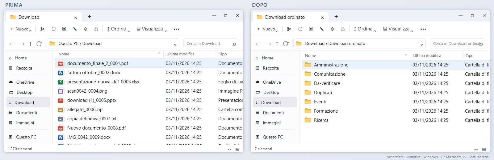

<p class="demo-caption">1051 classificati · 40 duplicati · 179 da verificare · nessun file cancellato</p>


## Accio, PDF! {#accio-pdf .dark .demo-local background-gradient="radial-gradient(82.5% 102.7% at 10% 0%, rgba(255,90,31,0.32), transparent 65%), radial-gradient(90.75% 117.3% at 95% 100%, rgba(124,58,237,0.42), transparent 65%), radial-gradient(43.75% 55.6% at 60% 40%, rgba(230,35,126,0.14), transparent 70%), linear-gradient(#0d1017, #0d1017)"}

<span class="magic-mark" aria-hidden="true">🪄</span>
<span class="demo-volume">600 iscritti</span>

::: {.demo-prompt}
> Ho 600 iscritti nel modulo di iscrizione del convegno. Vedi le ricevute di pagamento e controlla chi ha già pagato. Dai registri della segreteria vedi chi si è effettivamente presentato. Quindi prepara gli attestati di partecipazione in PDF in A4 per tutti quelli in regola
:::

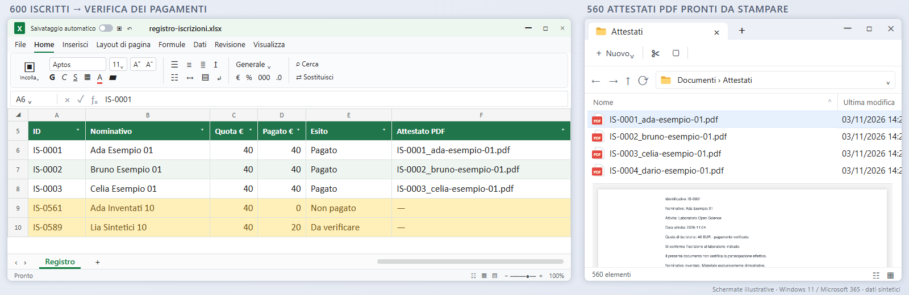

<p class="demo-caption">560 attestati PDF pronti da stampare · 28 pagamenti mancanti · 12 casi da verificare</p>

## Accio, Excel! {#accio-excel .dark .demo-local background-gradient="radial-gradient(82.5% 102.7% at 10% 0%, rgba(255,90,31,0.32), transparent 65%), radial-gradient(90.75% 117.3% at 95% 100%, rgba(124,58,237,0.42), transparent 65%), radial-gradient(43.75% 55.6% at 60% 40%, rgba(230,35,126,0.14), transparent 70%), linear-gradient(#0d1017, #0d1017)"}

<span class="magic-mark" aria-hidden="true">🪄</span>
<span class="demo-volume">350 documenti</span>

::: {.demo-prompt}
> Ho 350 documenti di segreteria e organi del dottorato. Trova tutte le informazioni relative a spese e finanziamenti. Prepara un Excel con importi, date, finalità e riferimento preciso al documento originale
:::

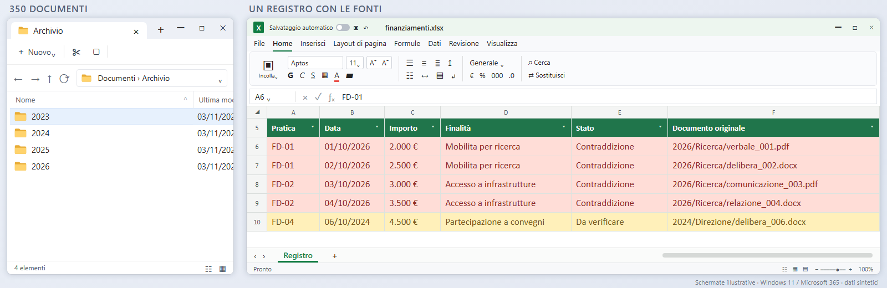

<p class="demo-caption">Un Excel con 24 decisioni e le fonti · 4 righe discordanti · 3 da verificare</p>


## Accio, burocrazia! {#accio-burocrazia .dark .demo-local background-gradient="radial-gradient(82.5% 102.7% at 10% 0%, rgba(255,90,31,0.32), transparent 65%), radial-gradient(90.75% 117.3% at 95% 100%, rgba(124,58,237,0.42), transparent 65%), radial-gradient(43.75% 55.6% at 60% 40%, rgba(230,35,126,0.14), transparent 70%), linear-gradient(#0d1017, #0d1017)"}

<span class="magic-mark" aria-hidden="true">🪄</span>
<span class="demo-volume">200 documenti</span>

::: {.demo-prompt}
> Devo compilare una relazione triennale sugli eventi svolti secondo il modulo fornito. Le informazioni sono sparse nei vari documenti che ho raccolto dentro questa cartella e in parte nella mia mail e negli allegati. Recuperale, compila direttamente il modello Word mantenendo la sua formattazione originale e segnala quello che manca, che è dubbio, o che richiede una mia decisione
:::

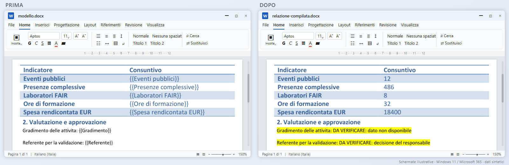

<p class="demo-caption">Il modello è compilato, con le stesse tabelle e gli stessi stili · 2 campi da verificare</p>

## Accio, sito aggiornato! {#accio-sito .dark .demo-local background-gradient="radial-gradient(82.5% 102.7% at 10% 0%, rgba(255,90,31,0.32), transparent 65%), radial-gradient(90.75% 117.3% at 95% 100%, rgba(124,58,237,0.42), transparent 65%), radial-gradient(43.75% 55.6% at 60% 40%, rgba(230,35,126,0.14), transparent 70%), linear-gradient(#0d1017, #0d1017)"}

<span class="magic-mark" aria-hidden="true">🪄</span>
<span class="demo-volume">150 pagine web</span>

::: {.demo-prompt}
> Questo sito ha molte pagine. Aggiorna all’anno accademico corrente con le informazioni pertinenti in base ai documenti forniti, correggi i link interni non funzionanti e preserva l’archivio storico a parte. Poi ricostruisci il sito e guarda che tutto funzioni.
:::

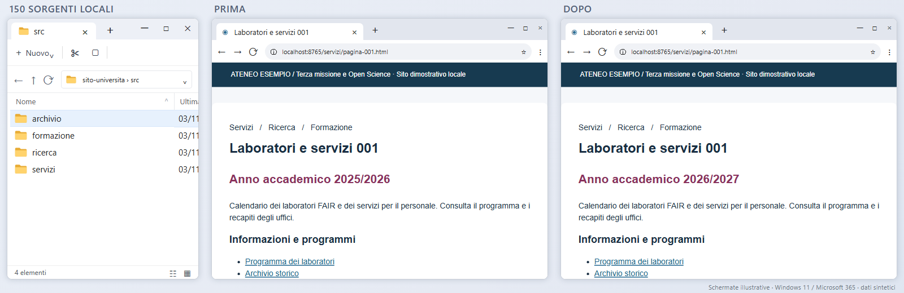

<p class="demo-caption">80 pagine aggiornate · 45 link corretti · build verificata · 30 pagine storiche intatte</p>

::: notes
Materiali sintetici: 150 sorgenti JSON interconnessi e una build HTML locale. Esecuzione di riferimento in demo-locali/06-sito: aggiornamento di 80 pagine correnti al 2026/2027, correzione di 45 link con redirects.json, ricostruzione di 150 HTML. Controllati tutti i 300 link interni: zero mancanti. Le 30 pagine storiche sono identiche byte per byte. Le cornici di Esplora file e del browser sono ricostruzioni illustrative; il contenuto del sito prima/dopo è renderizzato dai file locali effettivi. Eseguita anche la navigazione al programma corretto, senza pubblicazione. Dal vivo: nuova cartella con input, prompt.md e redirects.json; l’agent modifica i sorgenti, usa la build descritta nel README e controlla nel browser. Limite: piccolo sito statico dimostrativo, controllo di esistenza dei link senza autenticazione o backend.
:::

## Accio, R!

Anche scrivendo script R un agent che opera localmente può aiutare molto...

:::: {.columns}
::: {.column width="50%"}
### in chat

<div class="chat-line" style="justify-content: flex-start;">
<span class="step you">prompt</span>→<span class="step you">alleghi file</span>→<span class="step">chat risponde</span>→<span class="step you">incolli in RStudio</span>→<span class="step">R esegue</span>→<span class="step">errore</span>→<span class="step you">copi l'errore in chat</span>→<span class="step">…</span>→<span class="step you">rialleghi file aggiornati</span>→<span class="step">chat risponde</span>→<span class="step">…</span>
</div>
:::

::: {.column width="50%"}
### con un agente

<div class="chat-line" style="justify-content: flex-start;">
<span class="step you">prompt</span>→<span class="step">legge</span>→<span class="step">scrive</span>→<span class="step">esegue</span>→<span class="step">sbaglia</span>→<span class="step">corregge</span>→<span class="step">…</span>→<span class="step you">verifichi</span>
</div>

<p class="small muted" style="margin-top: 1em;">voi entrate all'inizio e alla fine, intanto vi fate un tè</p>
:::
::::


```{=html}
<div class="principio" style="margin-top: 1.5em;">
C'è lo stesso LLM della chat. Cambia che <b>lavora sui vostri file</b>, tutti, con i <b>vostri software locali</b>, ed <b>esegue direttamente</b>: lancia comandi, guarda l'errore, corregge, rilancia comandi, e lascia i risultati su disco (il risultato può essere un report, ma anche un intero sito, un'intera app, ecc.)
</div>
```


## 🕯️ La cartella locale come centro di comando

:::: {.columns}
::: {.column width="55%"}
<div class="small">

Un "progetto" di solito è sparso in:

- tanti **file** sul vostro computer
- le **decisioni** sono testimoniate nelle email
- varie versioni condivise su **Drive**
- le **scadenze** stanno nel calendario

**Il collante, finora, era la nostra memoria.**

</div>
:::
::: {.column width="45%"}
<div class="small">

Con i **connettori** l'agente vede tutto insieme: cartella + posta + calendario + Drive (+ il browser, con *Claude in Chrome*).

<p class="muted">Mail, eventi e condivisioni partono solo col vostro clic.</p>

</div>
:::
::::

```{=html}
<div class="trucco">Un documento locale <b><code>AGENTS.md</code></b> può mappare quello che sta "fuori" dal contesto locale: le cartella di Drive pertinente, il calendario, le parole chiave nelle mail, i nomi dei collaboratori...</div>
```


<!-- ---- cose fatte ---- -->

## delegare agli agents: Catalogo Open Science DPG

<p class="cap" style="font-size:20px;"><a href="https://opensciencedpg.github.io/OS-promotion/" target="_blank" rel="noopener noreferrer">https://opensciencedpg.github.io/OS-promotion/</a></p>
<iframe src="https://opensciencedpg.github.io/OS-promotion/" style="width: 100%; height: 640px; border: 1px solid #ddd; border-radius: 8px;"></iframe>

```{=comment}
## progetto riproducibilità & FAIRness paper DPG

<!--<p class="cap">report completo: <a href="demo/report-riproducibilita.html" target="_blank" rel="noopener noreferrer">apri in una nuova scheda</a></p>-->
<!-- online: versione anonimizzata (demo/, da R/report-anonimo.R); in locale: versione completa (local/, non su git) -->
<iframe id="report-ripr" src="demo/report-riproducibilita.html" style="width: 100%; height: 680px; border: 1px solid #ddd; border-radius: 8px;"></iframe>
<script>
if (location.protocol === "file:" || ["localhost", "127.0.0.1"].includes(location.hostname))
  document.getElementById("report-ripr").src = "local/report-riproducibilita.html";
</script>
```

## delegare agli agents: un videogioco

<iframe src="https://drive.google.com/file/d/1073IkTNHvEg_nCDm4ND4jXph7lDyvB-e/preview" style="width: 100%; height: 600px; border: 0; border-radius: 8px;" allow="autoplay; fullscreen" allowfullscreen></iframe>
<p class="cap"><a href="https://github.com/EnricoToffalini/mahabharata-game" target="_blank" rel="noopener noreferrer">mahabharata-game</a> • <a href="https://godotengine.org/" target="_blank" rel="noopener noreferrer" title="Apri approfondimento in una nuova scheda">Godot</a></p>

## delegare agli agents: il vostro browser

Lo stesso agent può anche **aprirsi il vostro Chrome e usarlo**

```{=html}
<div style="display: grid; grid-template-columns: 1fr auto 1fr auto 1fr; align-items: stretch; gap: 0.4em; margin-top: 0.6em;">
<div class="card" style="height: auto;"><h4>🖥️ l'agent, sul vostro PC</h4>Claude Code o Codex: legge il prompt, decide il prossimo passo, e intanto può lavorare anche sui vostri file</div>
<div style="align-self: center; font-size: 1.3em;">⇄</div>
<div class="card" style="--c: var(--accent2); height: auto;"><h4>🧩 l'estensione, in Chrome</h4>gli fa "vedere" la pagina (screenshot e struttura) ed esegue i suoi clic e quello che scrive</div>
<div style="align-self: center; font-size: 1.3em;">⇄</div>
<div class="card" style="--c: var(--accent3); height: auto;"><h4>🌐 i siti, con i vostri login</h4>lavora in schede sue, bordate di arancione: potete guardarlo o fermarlo; prima di pagare o inviare chiede</div>
</div>

<div class="trucco" style="margin-top: 1em; font-size: 0.62em;">
<b>Cosa serve</b>
<ul style="margin: 0.15em 0 0 0; padding-left: 1.2em;">
<li><b>Chrome aperto</b>, con attiva <b>l'estensione del vostro agent</b>, collegata allo stesso account. Poi:
<ul style="margin: 0.1em 0 0 0; padding-left: 1.2em;">
<li>se usate <b>Claude Code</b>: <a href="https://chromewebstore.google.com/detail/claude/fcoeoabgfenejglbffodgkkbkcdhcgfn" target="_blank" rel="noopener noreferrer">Claude in Chrome</a> (lo propone lui alla prima richiesta, o con <code>/chrome</code>) · <a href="https://code.claude.com/docs/en/chrome" target="_blank" rel="noopener noreferrer">guida</a></li>
<li>se usate <b>Codex</b>: l'estensione <a href="https://chromewebstore.google.com/detail/codex/hehggadaopoacecdllhhajmbjkdcmajg" target="_blank" rel="noopener noreferrer">Codex</a>, dall'app desktop (Impostazioni → Computer Use) · <a href="https://learn.chatgpt.com/docs/chrome-extension" target="_blank" rel="noopener noreferrer">guida</a> · <span class="muted">disattivato con l'account GPT Edu di ateneo</span></li>
</ul></li>
<li>poi <b>basta chiederlo a parole</b>: «Vai sul sito di Trenitalia e trovami...» <em>(vedi esempio nella prossima slide)</em></li>
</ul>
</div>
```

::: notes
Come funziona: Claude Code (terminale o app desktop) parla con l'estensione Claude in Chrome. L'agent riceve screenshot e struttura della pagina, decide dove cliccare e cosa scrivere, guarda di nuovo, e così via: lo stesso ciclo "esegue → guarda → corregge" che fa con R, ma su una pagina web. Usa le schede del vostro Chrome, con i vostri login; le schede su cui lavora sono raggruppate e bordate di arancione. Con l'account Edu, Codex non può usare il browser (disattivato dall'ateneo); Claude Code con l'estensione per Chrome sì.
:::

## Accio, treno!  {#accio-treno .dark .demo-local background-gradient="radial-gradient(82.5% 102.7% at 10% 0%, rgba(255,90,31,0.32), transparent 65%), radial-gradient(90.75% 117.3% at 95% 100%, rgba(124,58,237,0.42), transparent 65%), radial-gradient(43.75% 55.6% at 60% 40%, rgba(230,35,126,0.14), transparent 70%), linear-gradient(#0d1017, #0d1017)"}

<span class="magic-mark" aria-hidden="true">🪄</span>

::: {.demo-prompt}
> Vai sul sito di Trenitalia e trovami il Frecciarossa più economico da Padova a Roma per venerdì 13, di mattina. Fermati prima del pagamento.
:::

<a href="https://enricotoffalini.github.io/blog/posts/agenti-cli/#pu%C3%B2-agire-anche-fuori-dal-computer-tramite-connettori" target="_blank" rel="noopener noreferrer" class="media-link" title="Apri la sezione pertinente della guida in una nuova scheda">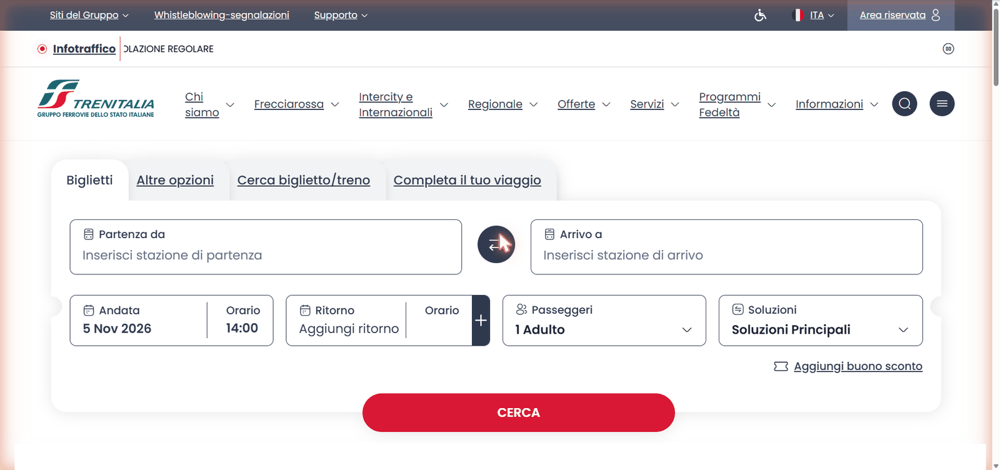</a>

## altro dove gli agents aiutano

<div class="examples-grid">
<div class="card">
<h4>personali</h4>
<ul class="link-list">
<li><a href="https://enricotoffalini.github.io/" target="_blank" rel="noopener noreferrer">Homepage personale</a></li>
<li><a href="https://enricotoffalini.github.io/blog/" target="_blank" rel="noopener noreferrer">Blog</a></li>
<li><a href="https://enricotoffalini.github.io/cv/" target="_blank" rel="noopener noreferrer">CV online</a></li>
<li><a href="https://github.com/EnricoToffalini/ai-skills" target="_blank" rel="noopener noreferrer">Skill AI personali</a></li>
</ul>
</div>
<div class="card">
<h4>siti ricerca</h4>
<ul class="link-list">
<li><a href="https://enricotoffalini.github.io/Most_interactions_are_wrong/" target="_blank" rel="noopener noreferrer">Most interactions are wrong</a></li>
<li><a href="https://enricotoffalini.github.io/Taxometrics-Neurodevelopmental-Disorders/" target="_blank" rel="noopener noreferrer">Taxometrics in neurodevelopmental disorders</a></li>
</ul>
</div>
<div class="card">
<h4>didattica e app</h4>
<ul class="link-list">
<li><a href="https://enricotoffalini.github.io/psicologia-intelligenza/" target="_blank" rel="noopener noreferrer">Psicologia dell'intelligenza</a></li>
<li><a href="https://enricotoffalini.github.io/slides/" target="_blank" rel="noopener noreferrer">Raccolta di slide</a></li>
<li><a href="https://enricotoffalini-dimensioni-diagnosi.share.connect.posit.cloud/" target="_blank" rel="noopener noreferrer">Dimensioni vs diagnosi</a></li>
</ul>
</div>
<div class="card">
<h4>edizioni e documenti</h4>
<ul class="link-list">
<li><a href="https://enricotoffalini.github.io/Epitteto-Diatribe/" target="_blank" rel="noopener noreferrer">Diatribe di Epitteto</a></li>
<li><a href="https://enricotoffalini.github.io/IDS-2-estensioni/" target="_blank" rel="noopener noreferrer">Indici IDS-2</a></li>
<li><a href="https://enricotoffalini.github.io/trasparenza-dati-normativi/" target="_blank" rel="noopener noreferrer">Trasparenza e dati normativi</a></li>
</ul>
</div>
</div>


## TRE COSE SULL'AI

<p class="center small" style="margin-top: 1.2em;"><a href="https://enricotoffalini.github.io/blog/posts/serie-ai/" target="_blank" rel="noopener noreferrer">enricotoffalini.github.io/blog/posts/serie-ai</a></p>
<br/>
<p class="muted small" style="margin-top: -0.3em;">cose minime da imparare per usare l'AI nel nostro lavoro (secondo me)</p>

:::: {.columns}
::: {.column width="33%"}

```{=html}
<a class="panel-link card" href="https://enricotoffalini.github.io/blog/posts/agenti-cli/" target="_blank" rel="noopener noreferrer" title="Apri la guida in una nuova scheda">
<h4>1 · agenti in locale</h4>
Claude Code e Codex lavorano <b>sui file del vostro computer</b>. Da terminale o da app.<br><br>
<span class="muted">la vera 💣</span>
</a>
```

:::
::: {.column width="33%"}

```{=html}
<a class="panel-link card" href="https://enricotoffalini.github.io/blog/posts/gpt-edu/" target="_blank" rel="noopener noreferrer" title="Apri la guida in una nuova scheda">
<h4>2 · ChatGPT Edu</h4>
Quello che l'ateneo già vi dà: come usarlo <b>bene</b> e senza sprecarlo.<br><br>
<span class="muted">~8.6 € l'anno, su fondi</span>
</a>
```

:::
::: {.column width="33%"}

```{=html}
<a class="panel-link card" href="https://enricotoffalini.github.io/blog/posts/skills/" target="_blank" rel="noopener noreferrer" title="Apri la guida in una nuova scheda">
<h4>3 · skill</h4>
Le vostre convenzioni (e la vostra expertise) scritte <b>una volta</b>, applicate sempre.<br><br>
<span class="muted">valgono sia in locale che su chat</span>
</a>
```

:::
::::

<!-- ============================ PARTE 1 ============================ -->

# {.dark background-gradient="radial-gradient(82.5% 102.7% at 10% 0%, rgba(255,90,31,0.32), transparent 65%), radial-gradient(90.75% 117.3% at 95% 100%, rgba(124,58,237,0.42), transparent 65%), radial-gradient(43.75% 55.6% at 60% 40%, rgba(230,35,126,0.14), transparent 70%), linear-gradient(#0d1017, #0d1017)"}

<div class="act-num">Parte 1</div>
<div class="big">agenti in locale</div>
<p class="muted">Claude Code e Codex: stessa richiesta, due agenti, terminale o app</p>

## installazione

:::: {.columns}
::: {.column width="50%"}
### [Claude Code](https://enricotoffalini.github.io/blog/posts/agenti-cli/claude-code.html#installazione){target="_blank" rel="noopener noreferrer"}

```bash
# Windows (PowerShell)
irm https://claude.ai/install.ps1 | iex

# macOS / Linux
curl -fsSL https://claude.ai/install.sh | bash

# alternativa: npm (tutti i sistemi)
npm install -g @anthropic-ai/claude-code
```
<p class="small muted">serve almeno Claude <b>Pro</b></p>
:::
::: {.column width="50%"}
### [Codex](https://enricotoffalini.github.io/blog/posts/agenti-cli/codex.html#installazione){target="_blank" rel="noopener noreferrer"}

```bash
# Windows (PowerShell)
powershell -ExecutionPolicy ByPass -c `
  "irm https://chatgpt.com/codex/install.ps1 | iex"
  
# macOS / Linux
curl -fsSL https://chatgpt.com/codex/install.sh | sh

# alternativa: npm (tutti i sistemi)
npm install -g @openai/codex
```
<p class="small muted">incluso in ChatGPT <b>Edu</b> e Plus</p>
:::
::::

<p class="small muted">Per l'opzione npm: installate prima <a href="https://nodejs.org/" target="_blank" rel="noopener noreferrer">Node.js LTS</a> (include npm).</p>

::: notes
Opzioni npm verificate nella documentazione ufficiale: https://code.claude.com/docs/en/setup#install-with-npm e https://developers.openai.com/cookbook/examples/codex/using_goals_in_codex . I comandi npm sono alternativi agli installer sopra: basta scegliere un metodo per ciascun agente.
:::

```{=html}
<div class="trucco">Chiudete e riaprite il terminale, poi <code>claude --version</code> / <code>codex --version</code>. Se non va: <code>claude doctor</code>.</div>
```


## tasto destro → apri nel terminale → `claude` o `codex` ↵

<a href="https://enricotoffalini.github.io/blog/posts/agenti-cli/claude-code.html#primo-avvio" target="_blank" rel="noopener noreferrer" class="media-link" title="Apri la sezione pertinente della guida in una nuova scheda">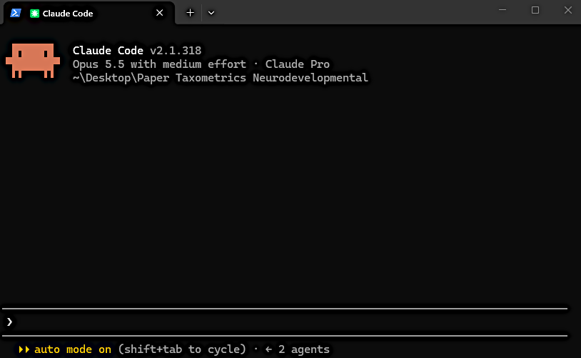</a>
<p class="cap">in alto: modello, effort, piano e <b>cartella di lavoro</b>. Da qui in poi si scrive in italiano</p>


```{=html}
<div class="trucco">L'agente vede per prima la cartella in cui lo lanciate (e le sottocartelle). <b>Lanciatelo nel posto giusto.</b></div>
```


## la richiesta

<div class="prompt" style="font-size: 0.85em;">In questa cartella c'è bii_campione.csv, il campione simulato di una batteria d'intelligenza inventata. Dai un'occhiata ai dati, poi scrivi uno script R chiamato analisi.R che descrive come crescono con l'età i punteggi grezzi dei quattro subtest, eseguilo e spiegami i risultati in poche righe.</div>

<p class="small muted">dati simulati della <b>BII</b>, una batteria inventata per la didattica (1.600 casi, 6-22 anni)</p>

<div class="fragment">

- legge i CSV e il `LEGGIMI.md`, **sceglie il metodo**
- **scrive** `analisi.R`
- lo **esegue** con il vostro R
- vi spiega i risultati

</div>

## Claude Code: 52 secondi

<a href="https://enricotoffalini.github.io/blog/posts/agenti-cli/claude-code.html#la-prima-richiesta" target="_blank" rel="noopener noreferrer" class="media-link" title="Apri la sezione pertinente della guida in una nuova scheda">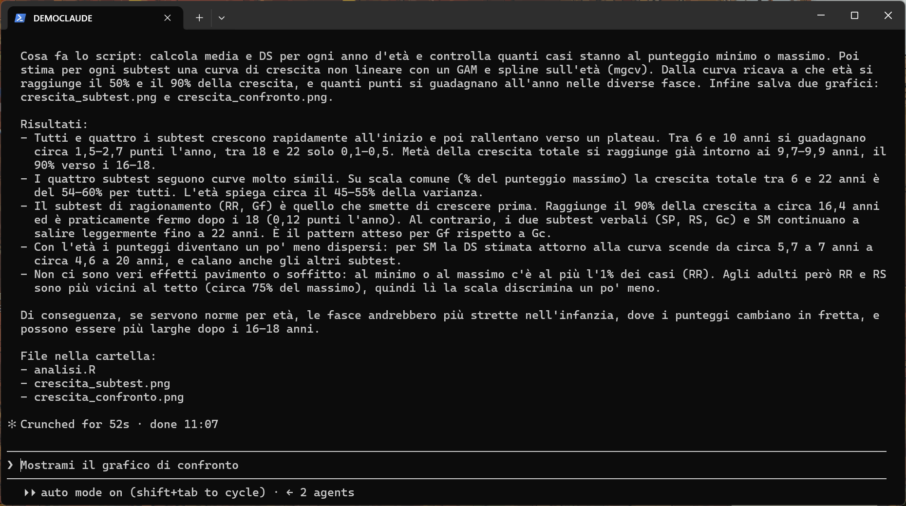</a>

::: notes
Da notare: ha scelto da solo un GAM per curve non lineari, ha controllato pavimento e soffitto, e ha aggiunto osservazioni non richieste (RR, Gf, si stabilizza prima dei subtest verbali; per norme per età servono fasce strette nell'infanzia).
:::

## Codex: 2 minuti, stesse stime

<a href="https://enricotoffalini.github.io/blog/posts/agenti-cli/codex.html#la-prima-richiesta" target="_blank" rel="noopener noreferrer" class="media-link" title="Apri la sezione pertinente della guida in una nuova scheda">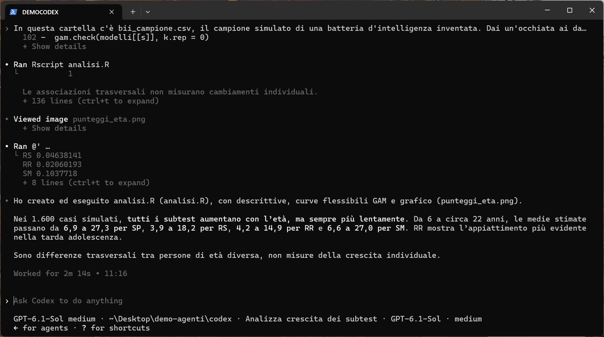</a>

<p class="cap">si vede tutto: <code>Ran Rscript analisi.R</code>, l'output, <code>Viewed image punteggi_eta.png</code> (ha guardato il grafico che ha prodotto)</p>

## e poi: "fammene un report Quarto"

:::: {.columns}
::: {.column width="50%"}
<a href="https://enricotoffalini.github.io/blog/posts/agenti-cli/#un-esempio-concreto-stesso-compito-due-agenti" target="_blank" rel="noopener noreferrer" class="media-link" title="Apri la sezione pertinente della guida in una nuova scheda">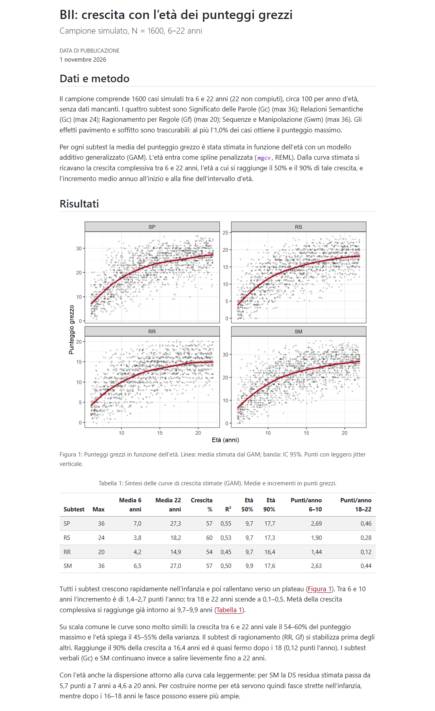</a>
<p class="cap">Claude Code</p>
:::
::: {.column width="50%"}
<a href="https://enricotoffalini.github.io/blog/posts/agenti-cli/#un-esempio-concreto-stesso-compito-due-agenti" target="_blank" rel="noopener noreferrer" class="media-link" title="Apri la sezione pertinente della guida in una nuova scheda">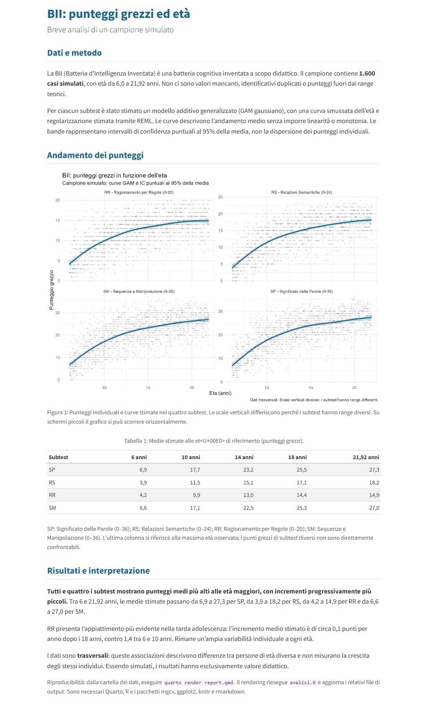</a>
<p class="cap">Codex</p>
:::
::::

## non piace il terminale? stessa cosa dall'app desktop

:::: {.columns}
::: {.column width="45%"}
<a href="https://enricotoffalini.github.io/blog/posts/agenti-cli/app-desktop.html#la-prima-richiesta" target="_blank" rel="noopener noreferrer" class="media-link" title="Apri la sezione pertinente della guida in una nuova scheda">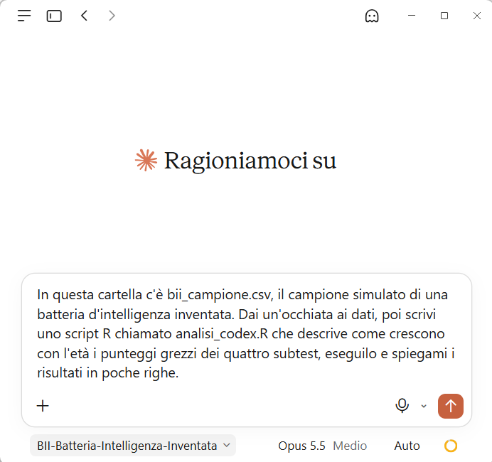</a>
<p class="cap">app Claude, scheda <b>Code</b>: cartella, modalità, modello sotto la casella</p>
:::
::: {.column width="55%"}
<a href="https://enricotoffalini.github.io/blog/posts/agenti-cli/app-desktop.html#la-prima-richiesta-1" target="_blank" rel="noopener noreferrer" class="media-link" title="Apri la sezione pertinente della guida in una nuova scheda">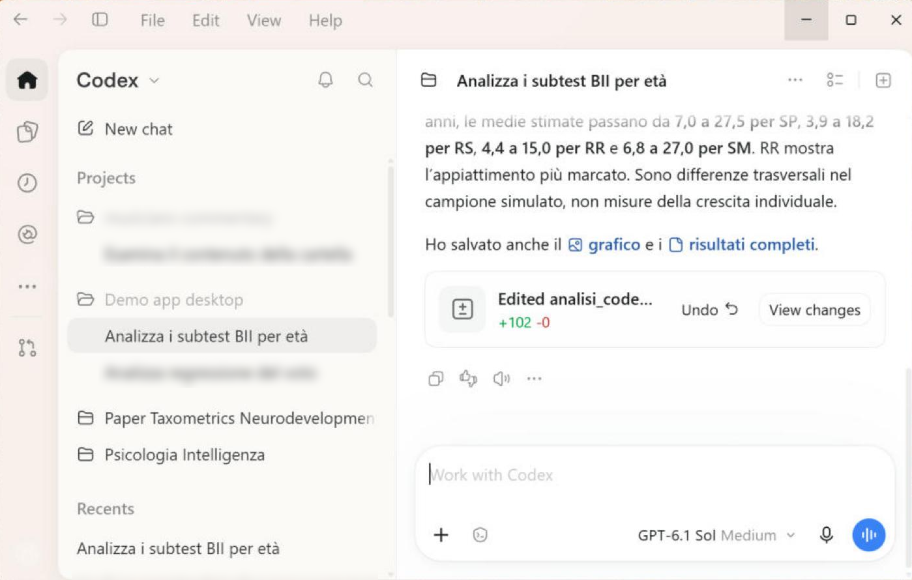</a>
<p class="cap">app ChatGPT, sezione <b>Codex</b>: stessa richiesta, stesso risultato</p>
<div class="small" style="margin-top: 0.6em;">

- stesso lavoro **in locale**, stesse skill
- ogni volta si sceglie la cartella (in Codex: un *progetto*)

</div>
:::
::::

## L'app ha un browser in cui controlla quello che fa

:::: {.columns}
::: {.column width="50%"}
<a href="https://enricotoffalini.github.io/blog/posts/agenti-cli/app-desktop.html#i-pannelli-dove-lapp-d%C3%A0-qualcosa-in-pi%C3%B9" target="_blank" rel="noopener noreferrer" class="media-link" title="Apri la sezione pertinente della guida in una nuova scheda">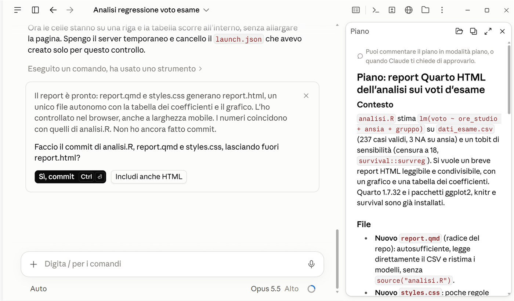</a>
<p class="cap">Claude: report controllato nel browser integrato, anche a larghezza da cellulare; il commit si approva con un clic</p>
:::
::: {.column width="50%"}
<a href="https://enricotoffalini.github.io/blog/posts/agenti-cli/app-desktop.html#pannelli-e-browser-integrato" target="_blank" rel="noopener noreferrer" class="media-link" title="Apri la sezione pertinente della guida in una nuova scheda">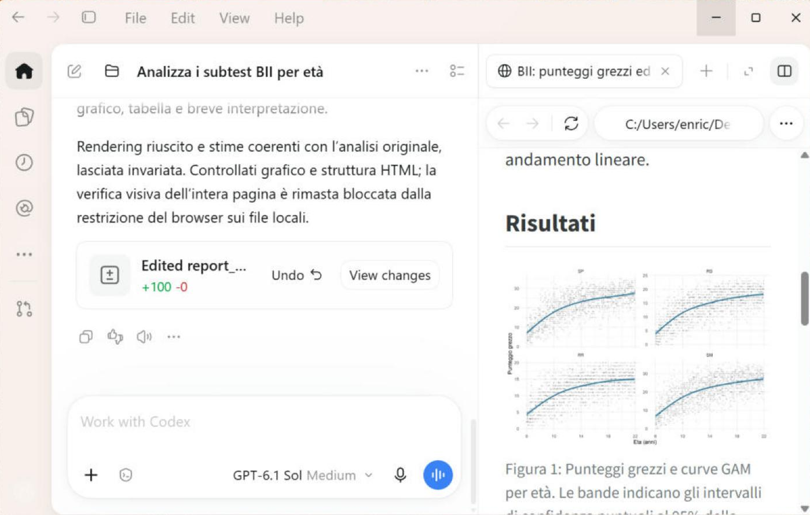</a>
<p class="cap">Codex: il report accanto alla chat</p>
:::
::::

<p class="small muted center">Io preferisco il terminale: non apro l'AI chiedendomi "cosa facciamo oggi?", la chiamo al bisogno <b>dentro la cartella in cui sto già lavorando</b></p>

<!-- ---- da sapere ---- -->

## da sapere n. 1: prima il `/plan`

:::: {.columns}
::: {.column width="50%"}
<a href="https://enricotoffalini.github.io/blog/posts/agenti-cli/claude-code.html#le-modalit%C3%A0-di-lavoro" target="_blank" rel="noopener noreferrer" class="media-link" title="Apri la sezione pertinente della guida in una nuova scheda">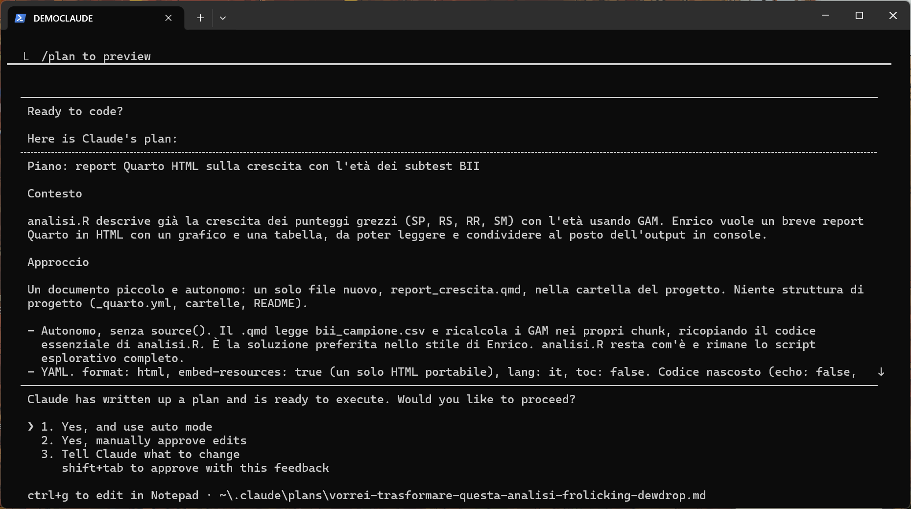</a>
<p class="cap">Claude Code, modalità <i>plan</i> (<code>Shift+Tab</code>)</p>
:::
::: {.column width="50%"}
<a href="https://enricotoffalini.github.io/blog/posts/agenti-cli/codex.html#plan-mode" target="_blank" rel="noopener noreferrer" class="media-link" title="Apri la sezione pertinente della guida in una nuova scheda">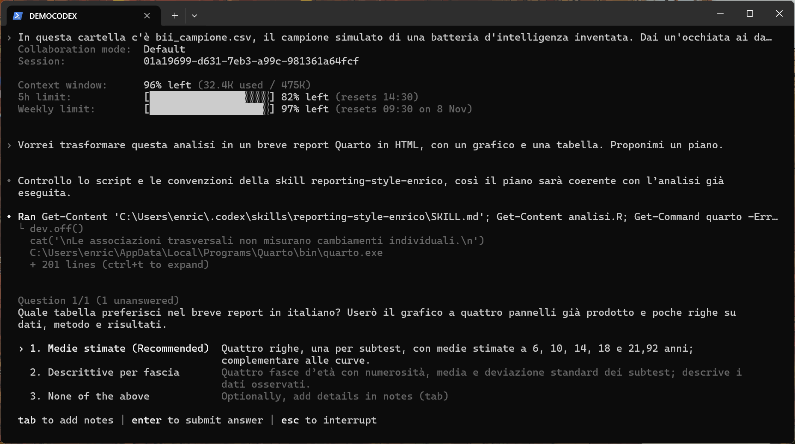</a>
<p class="cap">Codex, <code>/plan</code> o (<code>Shift+Tab</code>): prima di decidere <b>fa domande</b></p>
:::
::::

```{=html}
<div class="trucco">Per qualsiasi compito non banale: <i>"Non toccare niente: proponimi solo un piano."</i> Legge, esplora, non modifica nulla. Approvate, correggete, o ripartite.</div>
```


## da sapere n. 2: prima di fare, spiegami

:::: {.columns}
::: {.column width="40%"}
<div class="prompt" style="font-size: 0.68em;">Questa è la repo di un videogioco che non conosci. Senza modificare nulla, spiegami com'è fatto e quali file dovrei toccare per aggiungere un nuovo luogo da esplorare.</div>

<p class="muted small">35 secondi · solo lettura</p>


```{=html}
<div class="trucco">Il modo più economico per entrare in un progetto, vostro o altrui: la tesi di uno studente, il codice di un collega, un deposito OSF.</div>
```

:::
::: {.column width="60%"}
```{=html}
<div class="term"><span class="t">● Glob</span>  game/src/**/*.gd · docs/**/*.md
<span class="t">● Read</span>  main.gd · CURRENT_PROJECT_STATE.md · project.godot
<span class="t">● Read</span>  forest_party_prototype.gd · .tscn
<span class="d">  …</span>
<span class="ok">Motore: Godot 4, GDScript. Tutto il gioco sta in game/:
scene quasi vuote, logica in src/, episodi in JSON in content/.

Non c'è un mondo unico: "modalità" separate, scelte con
--mode= in main.gd:32. I luoghi sono costruiti via codice.

Per un nuovo luogo:
1. nuovo_luogo.gd + .tscn, sul modello della foresta
2. main.gd: preload, un caso nel match, la modalità (riga 55)
3. nemici? CombatRules.reset(), come chiede AGENTS.md
4. testi? un JSON in content/
5. poi smoke test headless: godot --headless -- --mode=…</span></div>
```
<p class="cap">Claude Code, trascrizione accorciata ? <a href="https://github.com/EnricoToffalini/mahabharata-game" target="_blank" rel="noopener noreferrer" title="Apri approfondimento in una nuova scheda">repository del videogioco ?</a></p>
:::
::::

::: notes
Prova del 1 novembre 2026 su una copia dei soli file di testo della repo (codice, scene, documentazione), mai sull'originale. Strumenti consentiti: solo Read, Glob, Grep.
:::

## da sapere n. 3: decidete voi quanta autonomia

:::: {.columns}
::: {.column style="width: 48%; padding-top: 1.2em;"}
<a href="https://enricotoffalini.github.io/blog/posts/agenti-cli/claude-code.html#le-modalit%C3%A0-di-lavoro" target="_blank" rel="noopener noreferrer" class="media-link" title="Apri la sezione pertinente della guida in una nuova scheda">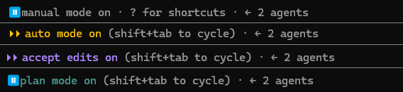</a>
:::
::: {.column style="width: 52%; font-size: 0.55em;"}
**Claude Code**: `Shift+Tab` nel terminale, menu in basso nell'app

- *Manual*: chiede prima di ogni modifica o comando
- *Auto*: fa da sé; un secondo modello blocca le azioni rischiose
- *Accept edits on*: modifica i file, chiede per i comandi
- *Plan*: legge e propone un piano, non modifica nulla
:::
::::

:::: {.columns}
::: {.column style="width: 48%; padding-top: 1.2em;"}
<a href="https://enricotoffalini.github.io/blog/posts/agenti-cli/codex.html#permessi" target="_blank" rel="noopener noreferrer" class="media-link" title="Apri la sezione pertinente della guida in una nuova scheda">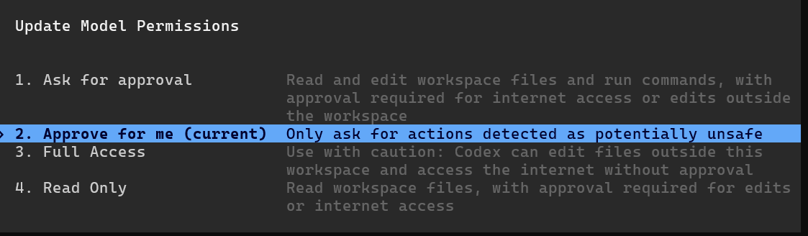</a>
:::
::: {.column style="width: 52%; font-size: 0.55em;"}
**Codex**: `/permissions` nel terminale, menu in basso nell'app

- *Ask for approval*: chiede solo per internet e file esterni
- *Approve for me*: fa da sé; chiede solo per le azioni rischiose
- *Full Access*: nessun limite, anche fuori dalla cartella e in rete
- *Read Only*: legge, chiede prima di modificare o andare in rete
- (`/plan` per pianificazione senza modifiche è attivato a parte)
:::
::::

```{=html}
<div class="trucco" style="font-size: 0.6em;">All'inizio <i>Manuale</i> / <i>Ask for approval</i>; poi <i>Auto</i> / <i>Approve for me</i>; accesso totale con cautela. <code>Esc</code> interrompe l'agente.</div>
```

## leggete il riepilogo finale

<a href="https://enricotoffalini.github.io/blog/posts/agenti-cli/codex.html#plan-mode" target="_blank" rel="noopener noreferrer" class="media-link" title="Apri la sezione pertinente della guida in una nuova scheda">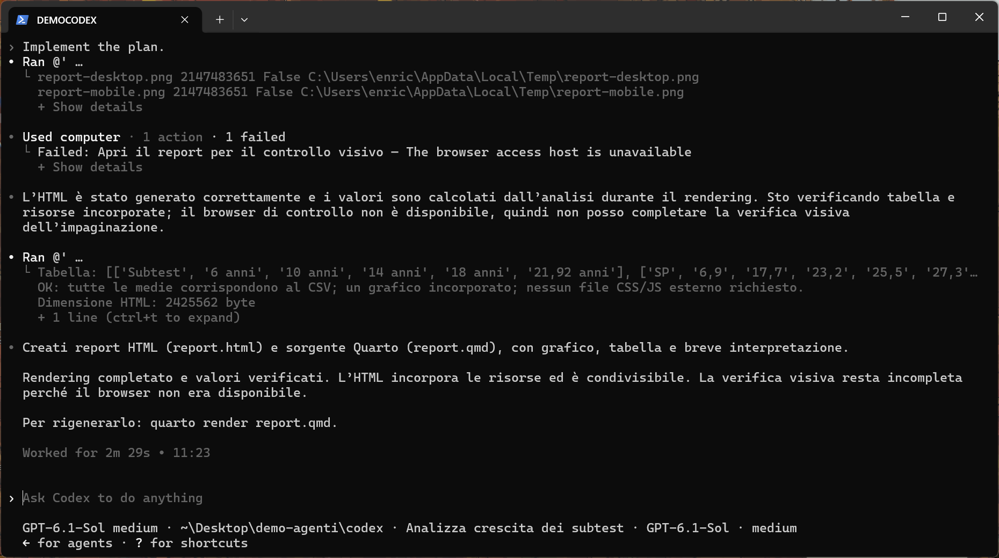</a>
<p class="cap">Codex: render riuscito, valori verificati, ma <i>"la verifica visiva resta incompleta"</i> (browser non disponibile). E infatti nel report è rimasto <code>et&lt;U+00E0&gt;</code></p>


```{=html}
<div class="trucco">L'agente dice <b>cosa ha controllato o completato e cosa no</b>. Quello che non ha fatto o deciso, fatelo o decidetelo voi (es. Codex via gptEdu da terminale non ha accesso al browser, potreste dover controllare voi visivamente).</div>
```


## da sapere n. 4: alzate il ragionamento quando serve

:::: {.columns}
::: {.column width="50%"}
<a href="https://enricotoffalini.github.io/blog/posts/agenti-cli/claude-code.html#scegliere-modello-ed-effort" target="_blank" rel="noopener noreferrer" class="media-link" title="Apri la sezione pertinente della guida in una nuova scheda">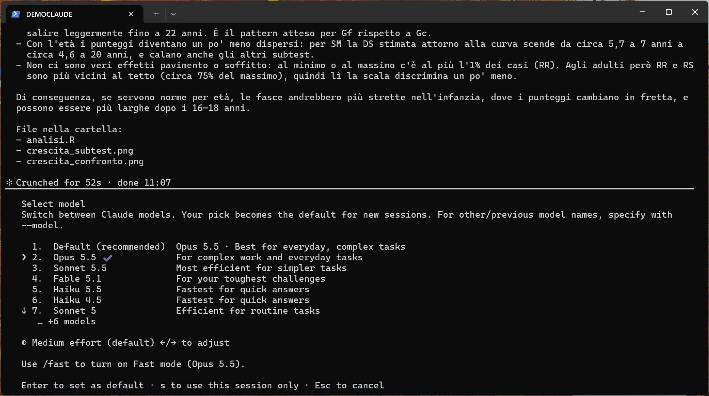</a>
<p class="cap">Claude Code, <code>/model</code>: ↑↓ modello, ←→ effort</p>
:::
::: {.column width="50%"}
<a href="https://enricotoffalini.github.io/blog/posts/agenti-cli/codex.html#scegliere-modello-e-livello-di-ragionamento" target="_blank" rel="noopener noreferrer" class="media-link" title="Apri la sezione pertinente della guida in una nuova scheda">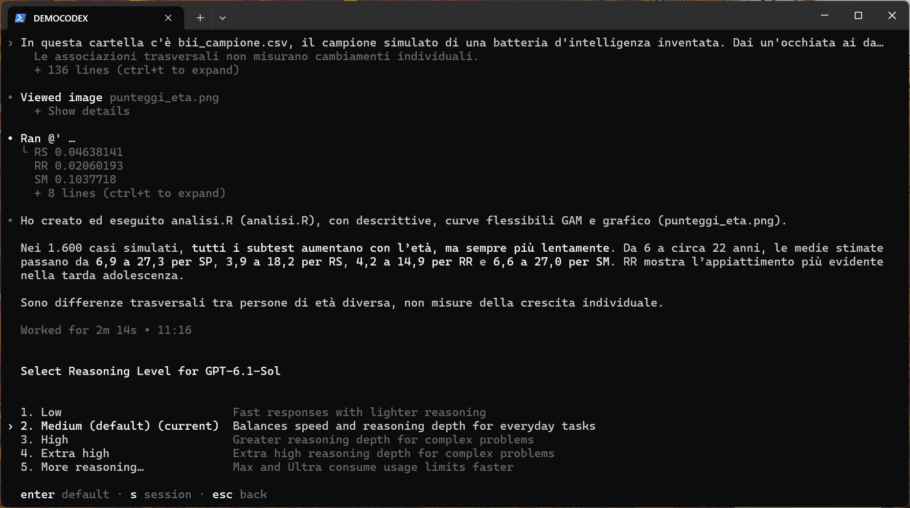</a>
<p class="cap">Codex: da <i>Low</i> a <i>Extra high</i>, più <i>Max</i> e <i>Ultra</i></p>
:::
::::


```{=html}
<div class="trucco">
  Partite dal default (effort <i>medium</i>).
  Compito difficile, o l'agente sbaglia?
  Alzate il modello/ragionamento.
  Lavoro ripetitivo e semplice? Modello più leggero.

  <ul>
    <li>Codex: <code>/model</code></li>
    <li>Claude: <code>/model</code> ed <code>/effort</code></li>
  </ul>

</div>
```


## modelli ed effort: due scelte diverse {#modelli-effort}

<p class="tiny muted">Aggiornato al 2 novembre 2026 · Modelli e livelli disponibili dipendono da piano, versione e amministratore. Fonti: <a href="https://learn.chatgpt.com/docs/models" target="_blank" rel="noopener noreferrer">OpenAI</a> · <a href="https://code.claude.com/docs/en/model-config" target="_blank" rel="noopener noreferrer">Anthropic</a>.</p>

<div class="small">

| Claude Code | Codex | In poche parole |
|:---|:---|:------------|
| **Fable 5.1** | **GPT-6 Astra** | Modelli di punta |
| **Opus 5.5** | **GPT-6.1 Sol** | Vicini a modelli di punta, ragionamento anche molto complesso; <u>raccomandati come base per uso agentico quotidiano che vada oltre domanda-risposta o compiti "meccanici"</u> |
| **Sonnet 5.5** | **GPT-6.1 Terra** | Versatili e rapidi per compiti non troppo complessi |
| **Haiku 5.5** | **GPT-6 Luna** | Leggeri ed economici: compiti semplici, modifiche mirate |

> **Effort**, in tutti i casi: **Low < Medium < High < Extra high / xhigh < Max**. 

- **Medium** è l'effort che raccomando sempre di base. 
- Nell'app Codex **Low** può chiamarsi **Light**.

**Sottoagenti:** Claude li lancia già da *Medium*; Codex su richiesta o a livello *Ultra*. In Claude, *Ultracode* pianifica workflow con sottoagenti su larga scala.

</div>

::: {.notes}
I sottoagenti non richiedono Ultra o Ultracode. Riferimenti: [Codex: sottoagenti](https://learn.chatgpt.com/docs/agent-configuration/subagents), [Claude Code: delega automatica](https://code.claude.com/docs/en/sub-agents#understand-automatic-delegation), [Claude Code: Ultracode e workflow](https://code.claude.com/docs/en/workflows#let-claude-decide-with-ultracode).
:::


## da sapere n. 5: guardate quanto *usage* vi resta

:::: {.columns}
::: {.column width="50%"}
<a href="https://enricotoffalini.github.io/blog/posts/agenti-cli/claude-code.html#controllare-lutilizzo-residuo" target="_blank" rel="noopener noreferrer" class="media-link" title="Apri la sezione pertinente della guida in una nuova scheda">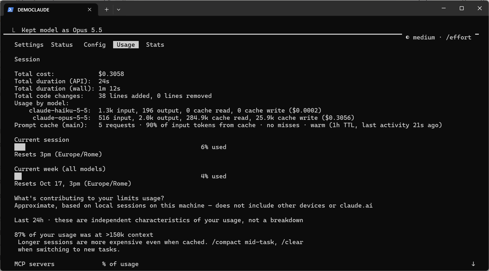</a>
<p class="cap">Claude Code, <code>/usage</code>: finestra di 5 ore e settimana</p>
:::
::: {.column width="50%"}
<a href="https://enricotoffalini.github.io/blog/posts/agenti-cli/codex.html#controllare-lutilizzo-residuo" target="_blank" rel="noopener noreferrer" class="media-link" title="Apri la sezione pertinente della guida in una nuova scheda">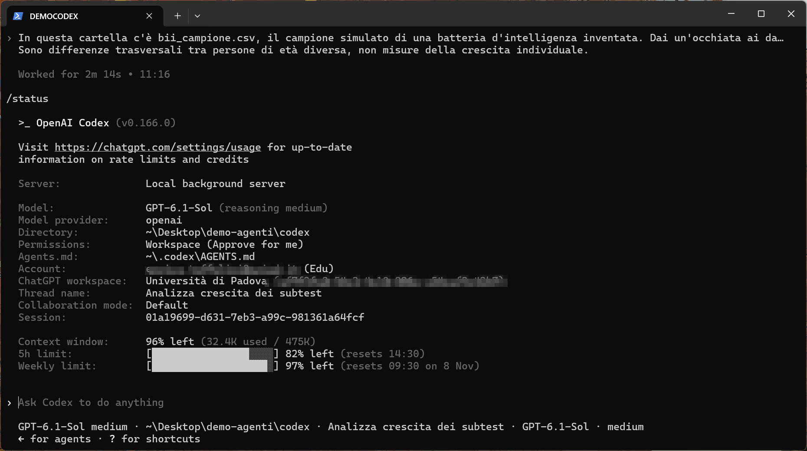</a>
<p class="cap">Codex, <code>/status</code>: account, contesto usato, limiti</p>
:::
::::


```{=html}
<div class="trucco"><b>Consumo</b> riflette <b>modello, effort, mole di lavoro agentico e ampiezza contesto</b>, non numero di messaggi (es. semplici domande-risposte) né solo tempo (es. potrebbe lanciare codice algoritmico). 
<br/><br/> 
<u>Una sessione per compito, please</u>. Cambio argomento? <code>/clear</code> (Claude) o <code>/new</code> (Codex).</div>
```


## da sapere n. 6: `resume` riprende una conversazione

:::: {.columns}
::: {.column width="50%"}
<a href="https://enricotoffalini.github.io/blog/posts/agenti-cli/claude-code.html#riprendere-una-conversazione" target="_blank" rel="noopener noreferrer" class="media-link" title="Apri la sezione pertinente della guida in una nuova scheda">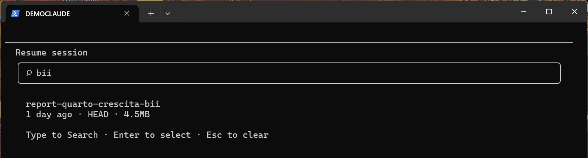</a>
<p class="cap">Claude Code, <code>claude -r</code>: conversazioni della cartella, con ricerca</p>
:::
::: {.column width="50%"}
<a href="https://enricotoffalini.github.io/blog/posts/agenti-cli/codex.html#riprendere-una-conversazione" target="_blank" rel="noopener noreferrer" class="media-link" title="Apri la sezione pertinente della guida in una nuova scheda">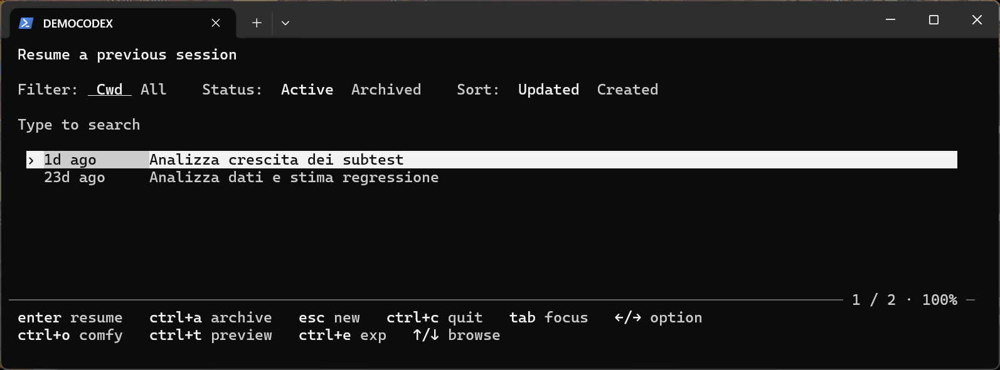</a>
<p class="cap">Codex, <code>codex resume</code>: elenco, filtri e anteprima</p>
:::
::::


```{=html}
<div class="trucco">Le conversazioni restano <b>salvate sul vostro computer</b>, legate alla cartella (⚠️ se cambiate nome alla cartella, potrebbero non essere più recuperabili). Terminale chiuso? limite di <em>usage</em> raggiunto? lavoro da continuare domani? Fate <code>resume</code> dalla stessa cartella e ripartite <b>con tutto il contesto</b>:
  <ul>
    <li>l'ultima: <code>claude -c</code> o <code>codex resume --last</code></li>
    <li>una a scelta: <code>claude -r</code> / <code>claude --resume</code> o <code>codex resume</code> (dentro una sessione: <code>/resume</code>)</li>
  </ul>
</div>
```


## il prontuario

<div class="cmd">

| | Claude Code | Codex |
|---|---|---|
| interrompere | `Esc` | `Esc` |
| piano prima di agire | `Shift+Tab` → *plan* | `Shift+Tab` o `/plan` |
| modello e ragionamento | `/model`, `/effort high` | `/model` |
| quanto mi resta | `/usage` | `/status` |
| nuova conversazione | `/clear` | `/new` |
| riassumere e liberare contesto | `/compact` | `/compact` |
| riprendere dopo un limite o una chiusura | `claude -c`, `claude -r` | `codex resume --last`, `codex resume` |
| tornare indietro, anche nel codice | `/rewind` | (Git) |
| file di istruzioni del progetto | `/init` → `CLAUDE.md` | `/init` → `AGENTS.md` |
| un comando del terminale al volo | `!git status` | |

</div>

<p class="small muted center">Digitando <code>/</code> compare l'elenco completo. Nelle app: gli stessi comandi, o i menu sotto la casella.</p>

## da sapere n. 7: un `AGENTS.md` sintetico nella cartella

:::: {.columns}
::: {.column width="52%"}
```markdown
# AGENTS.md

## Progetto
Articolo su interazioni e potenza statistica.
Analisi in R/, manoscritto in paper/main.qmd.

## Fuori dalla cartella
- Mail: etichetta "Interazioni-2026"
- Drive: cartella "Interazioni - condivisa"

## Regole
- Non modificare data/raw/.
- Render: quarto render paper/main.qmd
- Stato del lavoro: vedi NOTES.md
```
<p class="cap">esempio illustrativo</p>
:::
::: {.column width="48%"}
<div class="small">

- oppure `CLAUDE.md` se esclusivamente per Claude
- istruzioni di contesto, convenzioni da seguire
- letto sempre **all'avvio** (⚠️ occupa contesto)
- lo **stato del lavoro** può essere aggiornato qui
- nuova sessione = memoria azzerata: `AGENTS.md` è l'unico elemento di contesto alla partenza

</div>

```{=html}
<a href="https://enricotoffalini.github.io/blog/posts/agenti-cli/codex.html#altri-comandi-utili" target="_blank" rel="noopener noreferrer" title="Apri la sezione pertinente in una nuova scheda" class="panel-link trucco"><code>/init</code> ve ne scrive una prima bozza. Poi la correggete voi.</a>
```
:::
::::

```{=html}
<a href="https://enricotoffalini.github.io/blog/posts/agenti-cli/#il-contesto-%C3%A8-ricco-e-non-va-aggiornato-a-mano" target="_blank" rel="noopener noreferrer" title="Apri la sezione pertinente in una nuova scheda" class="panel-link trucco">Ricordate l'uso di <b><code>AGENTS.md</code></b> come mappa (quale cartella di Drive, quale calendario, cosa cercare nelle mail, chi sono i collaboratori...)</a>
```

## da sapere n. 8: formati aperti

:::: {.columns}
::: {.column width="50%"}

```{=html}
<div class="card">
<h4><code>.qmd</code> · <code>.R</code> · <code>.csv</code> · <code>.bib</code></h4>
legge → cambia una riga → fatto<br>
<span class="muted">con Git si vede e si annulla</span>
</div>
```

:::
::: {.column width="50%"}

```{=html}
<div class="card" style="border-top-color: #a1a1aa;">
<h4><code>.docx</code> · <code>.xlsx</code> · <code>.pptx</code> · <code>.sav</code></h4>
estrai → modifica → ricomponi → controlla<br>
<span class="muted">più tempo, più consumo, più errori</span>
</div>
```

:::
::::

<p class="center" style="margin-top: 1em;">FAIR per gli umani, FAIR per l'AI.</p>


```{=html}
<div class="trucco">E <b>Git</b>: ogni modifica dell'agente si vede e si annulla. I comandi non servono a memoria: <i>"fai un commit di queste modifiche"</i>, <i>"torna alla versione di ieri"</i>.</div>
```

<!-- ============================ PARTE 2 ============================ -->

# {.dark background-gradient="radial-gradient(82.5% 102.7% at 10% 0%, rgba(255,90,31,0.32), transparent 65%), radial-gradient(90.75% 117.3% at 95% 100%, rgba(124,58,237,0.42), transparent 65%), radial-gradient(43.75% 55.6% at 60% 40%, rgba(230,35,126,0.14), transparent 70%), linear-gradient(#0d1017, #0d1017)"}

<div class="act-num">Parte 2</div>
<div class="big">ChatGPT Edu</div>
<p class="muted">istruzioni per l'uso (e per non sprecarlo)</p>

::: notes
UniPD: 7 € al mese + IVA, circa 100 € l'anno, pagabili su fondi di ricerca. Molti lo usano solo per riformulare email. Condizioni negoziate dall'ateneo, ottobre 2026: altrove possono essere diverse.
:::

## Chat o Work? di default, Chat

<a href="https://enricotoffalini.github.io/blog/posts/gpt-edu/#chat-o-work-di-default-chat" target="_blank" rel="noopener noreferrer" class="media-link" title="Apri la sezione pertinente della guida in una nuova scheda">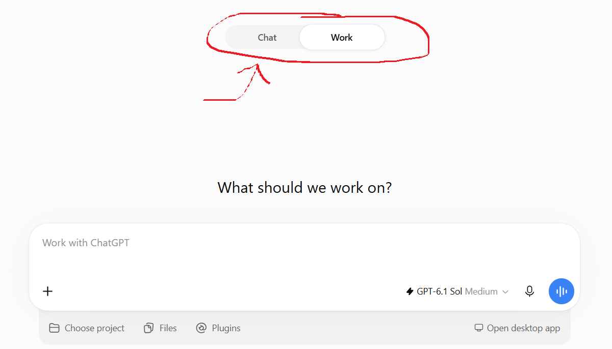</a>
<p class="cap">il selettore Chat / Work in alto; qui la modalità Work</p>


```{=html}
<div class="trucco"><b>Work = Codex in cloud</b>, con gli <b>stessi limiti</b> di Codex. Tutto ciò che si chiude in una Chat (anche con file caricati e scaricati) fatelo in Chat. Il credito Work tenetelo per Codex in locale.</div>
<div class="avviso"><b>Novità (<a href="https://help.openai.com/en/articles/20001625-understanding-chatgpt-and-codex-usage-limits" target="_blank" rel="noopener noreferrer">OpenAI</a>):</b> da dicembre, su Plus, Pro e Business, anche la Chat (tranne <i>Instant</i>) consumerà la stessa quota di Codex/Work. Per Edu, per ora, nessuna comunicazione: se arriverà, questa distinzione perde senso.</div>
```


## la cosa più importante: il livello di ragionamento

:::: {.columns}
::: {.column width="50%"}
<a href="https://enricotoffalini.github.io/blog/posts/gpt-edu/#modelli-e-livelli-di-ragionamento-la-cosa-pi%C3%B9-importante" target="_blank" rel="noopener noreferrer" class="media-link" title="Apri la sezione pertinente della guida in una nuova scheda">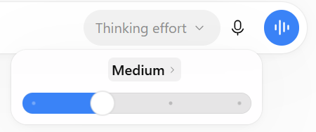</a>
<p class="cap"><i>Medium</i>: il default</p>
:::
::: {.column width="50%"}
<a href="https://enricotoffalini.github.io/blog/posts/gpt-edu/#modelli-e-livelli-di-ragionamento-la-cosa-pi%C3%B9-importante" target="_blank" rel="noopener noreferrer" class="media-link" title="Apri la sezione pertinente della guida in una nuova scheda">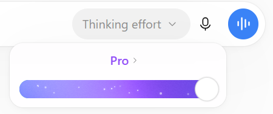</a>
<p class="cap"><i>Pro</i>: all'estremo destro</p>
:::
::::

| Livello | Quando |
|---|---|
| **Instant** | riformulazioni, traduzioni semplici |
| **Medium** | la maggior parte delle richieste |
| **High** | statistica, codice, revisione critica: **nel dubbio, questo** |
| **Pro** | problemi davvero difficili; lento e contingentato |

## in Chat, High senza scrupoli

<div class="big grad" style="font-size: 1.5em; margin-top: 0.5em;">moltissimi prompt a <i>High</i> → mai un limite</div>

<p class="muted small">nella mia esperienza con ChatGPT Edu</p>

<div class="small" style="margin-top: 1em;">

- i limiti si sentono in **Work** (sono quelli di Codex: 5 ore + settimana)
- e soprattutto con **Thinking Effort: Pro** (in un periodo: 16 richieste al mese)

</div>


```{=html}
<div class="trucco">È la cosa che quasi nessuno tocca. Spostate il cursore su <b>High</b> e lasciatelo lì.</div>
<div class="avviso">Vale finché la Chat ha limiti separati: da dicembre, su Plus, Pro e Business, la Chat a <i>Medium</i>/<i>High</i> attingerà alla quota di Codex. Per Edu non si sa ancora.</div>
```


## il **+**: ricerca web e Deep research

<a href="https://enricotoffalini.github.io/blog/posts/gpt-edu/#strumenti-ricerca-web-e-deep-research" target="_blank" rel="noopener noreferrer" class="media-link" title="Apri la sezione pertinente della guida in una nuova scheda">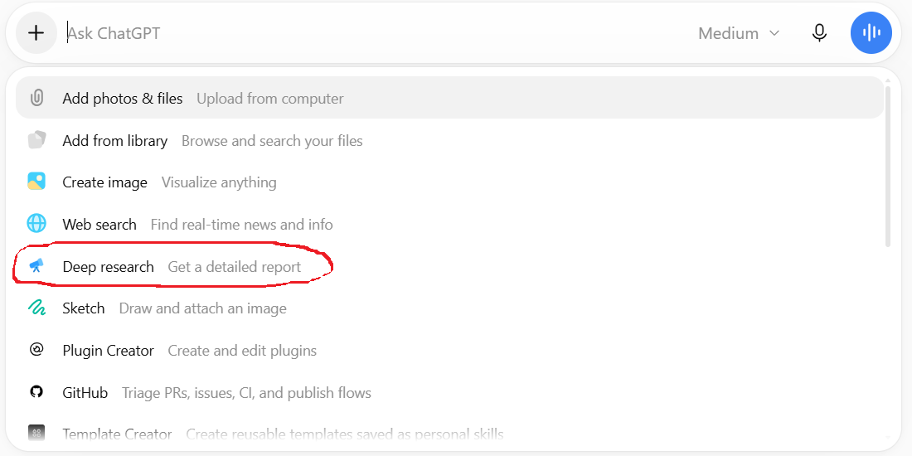</a>

<div class="small">

- **Web search**: fonti aggiornate, con link
- **Deep research**: lavora per minuti, consulta decine di fonti, restituisce un **report con citazioni**

</div>


```{=html}
<div class="trucco">Deep research prima fa domande: rispondete con cura, il risultato dipende da lì. E le fonti scientifiche controllatele <b>una per una</b>.</div>
```


## scrivete @: i connettori

<a href="https://enricotoffalini.github.io/blog/posts/gpt-edu/#connettori-gmail-calendar-github-drive" target="_blank" rel="noopener noreferrer" class="media-link" title="Apri la sezione pertinente della guida in una nuova scheda">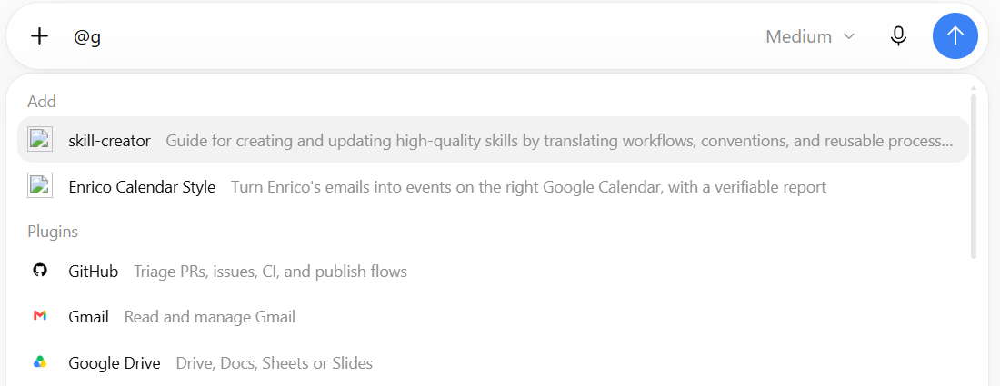</a>
<p class="cap">digitando <b>@</b> compaiono skill e plugin collegati (qui filtrati con "g")</p>

<div class="prompt">@Gmail riassumimi le mail della settimana che richiedono una mia risposta, in ordine di urgenza.</div>
<div class="prompt">@Gmail trova le mail sul progetto X degli ultimi tre mesi e ricostruiscimi cosa abbiamo deciso.</div>
<div class="prompt">@Google Calendar quando ho due ore libere la prossima settimana per una riunione?</div>
<div class="prompt">@GitHub cosa è cambiato nella repository Y nell'ultimo mese?</div>

## dove si attivano: la pagina Plugins

<a href="https://enricotoffalini.github.io/blog/posts/gpt-edu/#connettori-gmail-calendar-github-drive" target="_blank" rel="noopener noreferrer" class="media-link" title="Apri la sezione pertinente della guida in una nuova scheda">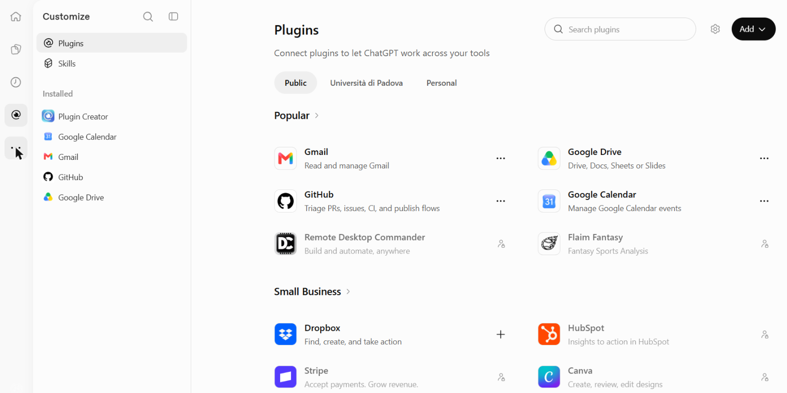</a>
<p class="cap">a sinistra quelli installati, a destra il catalogo</p>


```{=html}
<div class="trucco">Controllate sempre prima che invii o modifichi qualcosa. Quello che legge passa dai server di OpenAI: attenzione ai dati sensibili.</div>
```


## progetti: contesti delimitati con fonti e istruzioni

:::: {.columns}
::: {.column width="40%"}
<a href="https://enricotoffalini.github.io/blog/posts/gpt-edu/#progetti-contesto-e-fonti-che-restano" target="_blank" rel="noopener noreferrer" class="media-link" title="Apri la sezione pertinente della guida in una nuova scheda">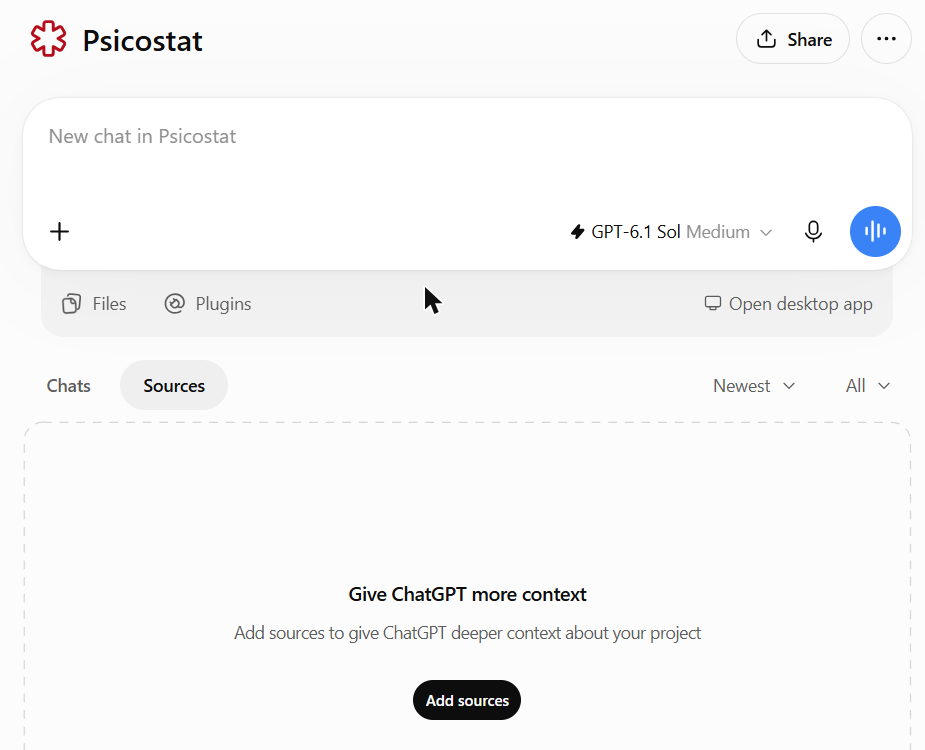</a>
<p class="cap">fonti ancora vuote: un'occasione sprecata</p>
:::
::: {.column width="30%"}
<a href="https://enricotoffalini.github.io/blog/posts/gpt-edu/#progetti-contesto-e-fonti-che-restano" target="_blank" rel="noopener noreferrer" class="media-link" title="Apri la sezione pertinente della guida in una nuova scheda">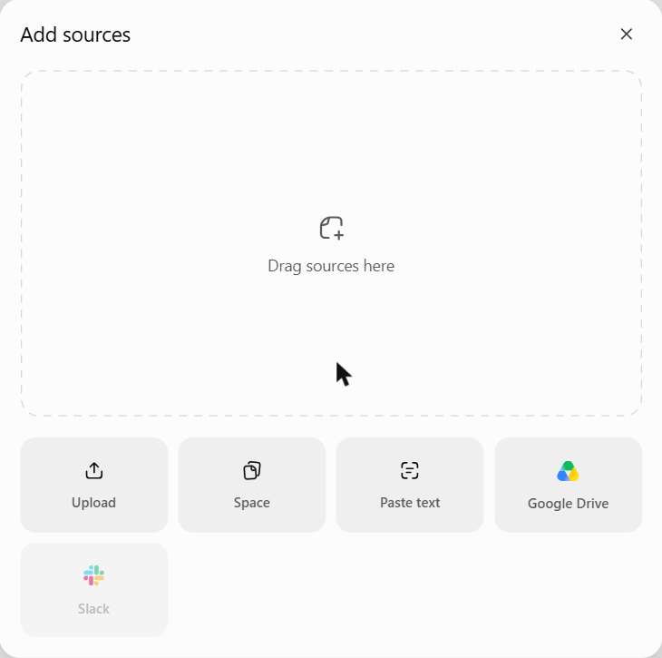</a>
<p class="cap"><i>Add sources</i>: file, testo, Drive</p>
:::
::: {.column width="30%"}
<a href="https://enricotoffalini.github.io/blog/posts/gpt-edu/#progetti-contesto-e-fonti-che-restano" target="_blank" rel="noopener noreferrer" class="media-link" title="Apri la sezione pertinente della guida in una nuova scheda">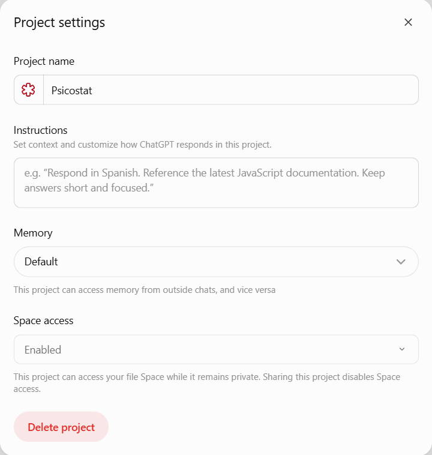</a>
<p class="cap"><i>Project settings</i>: istruzioni e memoria separata</p>
:::
::::


```{=html}
<div class="trucco">Non solo cartelle per le chat. Es.: <b>revisione di un articolo</b> (manoscritto + linee guida come fonti) · <b>studenti di tesi</b> (regolamento e scadenze) · <b>un corso</b> (programma, slide, domande d'esame).</div>
```


## per andare oltre

:::: {.columns}
::: {.column width="50%"}
<a href="https://enricotoffalini.github.io/blog/posts/gpt-edu/#per-andare-oltre-skill-attivit%C3%A0-pianificate-agenti" target="_blank" rel="noopener noreferrer" class="media-link" title="Apri la sezione pertinente della guida in una nuova scheda">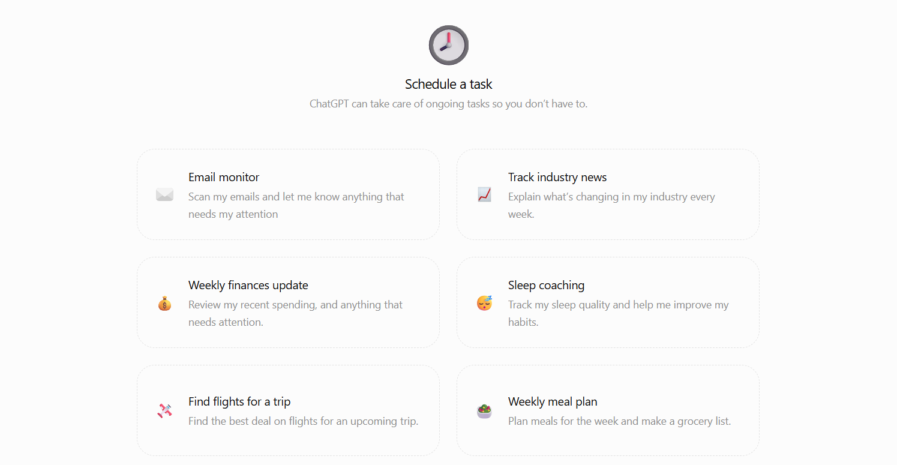</a>
<p class="cap"><b>attività pianificate</b>: la stessa richiesta a intervalli regolari</p>
<div class="prompt" style="font-size: 0.55em;">ogni mattina: @Gmail guarda le mail arrivate da ieri e dimmi cosa richiede una mia risposta o contiene una scadenza</div>
:::
::: {.column width="50%"}
<a href="https://github.com/EnricoToffalini/ai-skills" target="_blank" rel="noopener noreferrer" class="media-link" title="Apri le mie skill su GitHub in una nuova scheda"></a>
<p class="cap"><b>skill</b>: le stesse di Codex e Claude (→ parte 3)</p>
<a href="https://enricotoffalini.github.io/blog/posts/gpt-edu/#per-andare-oltre-skill-attivit%C3%A0-pianificate-agenti" target="_blank" rel="noopener noreferrer" class="media-link" title="Apri la sezione pertinente della guida in una nuova scheda">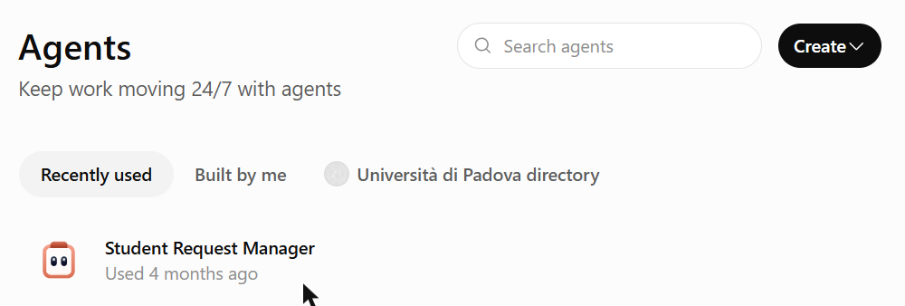</a>
<p class="cap"><b>agenti</b> condivisibili nella directory di ateneo</p>
:::
::::

## e soprattutto: Edu include Codex

<div class="big grad" style="font-size: 1.6em; margin-top: 0.4em;">Chat per ordinaria amministrazione.<br>Codex per sviluppare progetti.</div>

<div class="small" style="margin-top: 1em;">

- stesso login di ChatGPT Edu: <code>codex</code> → *Sign in with ChatGPT*
- tutto quello della parte 1, con il vostro account di ateneo
- il browser per Codex, con Edu, è disattivato dall'ateneo

</div>


```{=html}
<div class="trucco">Il credito Work/Codex è quello che finisce: <b>non sprecatelo in Work</b> per cose che una Chat a <i>High</i> risolve.</div>
<div class="avviso">Se la novità di dicembre (Plus, Pro, Business) arriverà anche su Edu, Chat e Codex attingeranno allo stesso credito: conterà scegliere lo strumento più adatto, non “risparmiare” Work.</div>
```


<!-- ============================ PARTE 3 ============================ -->

# {.dark background-gradient="radial-gradient(82.5% 102.7% at 10% 0%, rgba(255,90,31,0.32), transparent 65%), radial-gradient(90.75% 117.3% at 95% 100%, rgba(124,58,237,0.42), transparent 65%), radial-gradient(43.75% 55.6% at 60% 40%, rgba(230,35,126,0.14), transparent 70%), linear-gradient(#0d1017, #0d1017)"}

<div class="act-num">Parte 3</div>
<div class="big">skill</div>
<p class="muted">come smettere di correggere sempre le stesse cose</p>

## vi suona familiare? {.familiare}

<div class="prompt">analizza quota articoli con open data per anno</div>

<p class="small muted">senza skill: otto pacchetti tidyverse, anche se voi non li usate e manco vi piacciono (eccetto ggplot2 ❤️)</p>

```r
library(tidyverse)
pubs <- read_csv("data/publications.csv")
pubs %>% mutate(open_data = str_detect(practices, "open_data")) %>%
      group_by(year) %>% 
      summarise(n = n(), quota = mean(open_data)) %>% 
      ungroup()
```

<p class="small muted">con la mia <a href="https://github.com/EnricoToffalini/ai-skills" target="_blank" rel="noopener noreferrer" title="Apri approfondimento in una nuova scheda">skill sul codice "`coding-style-enrico`"</a></p>

```r
pubs = read.csv("data/publications.csv")
pubs$open_data = grepl("open_data", pubs$practices)
aggregate(open_data ~ year, data = pubs, FUN = mean)
```

## il modello non sbaglia: vi dà la risposta "media" {.medium}

| | senza skill (risposta "media") | con skill personalizzata |
|-----|-----|-----|
| [**codice**](https://github.com/EnricoToffalini/ai-skills){target="_blank" rel="noopener noreferrer"} | preferenza per python, in R usa tidyverse, funzioni e controlli ovunque, fortemente ingegnerizzato | preferenza R base, dall'alto in basso, naive ma leggibile |
| [**report**](https://github.com/EnricoToffalini/ai-skills){target="_blank" rel="noopener noreferrer"} | un HTML bellissimo, sorgente chissà | Quarto, forever |
| [**email**](https://github.com/EnricoToffalini/ai-skills){target="_blank" rel="noopener noreferrer"} | tre righe di convenevoli | subito al punto |
| [**calendario**](https://github.com/EnricoToffalini/ai-skills){target="_blank" rel="noopener noreferrer"} | "ho creato un evento": inserisce attività generica con nome troppo lungo | il calendario giusto con le convenzioni giusti |

```{=html}
<div class="trucco">Correggete l'output AI per lo stesso motivo per la terza volta? <b>Fatevi una skill!</b></div>
```


## cos'è una skill

:::: {.columns}
::: {.column width="58%"}
<a href="https://github.com/EnricoToffalini/ai-skills" target="_blank" rel="noopener noreferrer" class="media-link" title="Apri le mie skill su GitHub in una nuova scheda">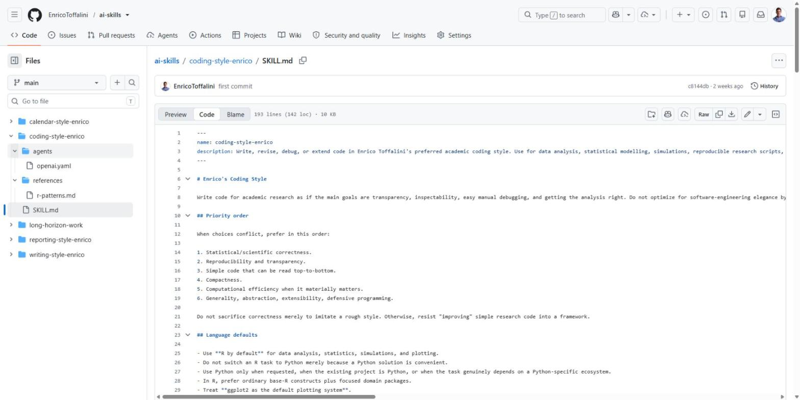</a>
:::
::: {.column width="42%"}
<div class="small">

- una **cartella** con un `SKILL.md`
- in testa: **nome** e **descrizione** (quando usarla)
- sotto: regole, in testo libero
- accanto: riferimenti, modelli, script
- [**standard aperto**](https://agentskills.io){target="_blank" rel="noopener noreferrer"}: Claude e ChatGPT/Codex, chat e agenti

</div>
:::
::::

## perché se ne possono avere tante

Cosa finisce caricato nel contesto 

```{=html}
<div class="tier t1"><b>1 · nome e descrizione</b> di tutte le skill <span class="tok">sempre, poche righe</span></div>
```


```{=html}
<div class="tier t2 fragment"><b>2 · <code>SKILL.md</code></b> completo <span class="tok">solo se la richiesta corrisponde</span></div>
```


```{=html}
<div class="tier t3 fragment"><b>3 · i file in <code>references/</code></b>, <b><code>scripts/</code></b>, ecc. <span class="tok">se servono</span></div>
```


```{=html}
<a href="https://enricotoffalini.github.io/blog/posts/skills/#cos%C3%A8-una-skill" target="_blank" rel="noopener noreferrer" title="Apri la sezione pertinente in una nuova scheda" class="panel-link trucco fragment">La <b>descrizione</b> è la parte più importante: decide se la skill verrà usata. Dite <b>cosa</b> fa e <b>quando</b>, con le parole che usereste nelle richieste.</a>
```


## skill, istruzioni, memoria: cosa cambia

<div class="small">

| | vale per | limite |
|----|---|----|
| **istruzioni personalizzate** | tutte le conversazioni | brevi e generiche; sempre attive |
| **memoria** automatica | tutte le conversazioni | decide l'AI cosa ricordare |
| **istruzioni di progetto** (progetti su chat, `AGENTS.md` per agents) | un progetto | da scrivere per ogni progetto |
| **skill** | un **tipo di compito** | da scrivere con cura una volta sola |

</div>


```{=html}
<a href="https://github.com/EnricoToffalini/ai-skills" target="_blank" rel="noopener noreferrer" title="Apri approfondimento in una nuova scheda" class="panel-link principio">Una skill è legata a <b>che tipo di compito</b> state chiedendo, non a <b>dove</b>: quella sul codice R si attiva quando si scrive codice R, in qualsiasi progetto e con qualsiasi strumento.</a>
```


## {.dark background-gradient="radial-gradient(82.5% 102.7% at 10% 0%, rgba(255,90,31,0.32), transparent 65%), radial-gradient(90.75% 117.3% at 95% 100%, rgba(124,58,237,0.42), transparent 65%), radial-gradient(43.75% 55.6% at 60% 40%, rgba(230,35,126,0.14), transparent 70%), linear-gradient(#0d1017, #0d1017)"}

<span class="magic-mark" aria-hidden="true">🪄</span>

<p>Avevo chiesto solo <i>"un breve report"</i>: Codex si va a leggere <b>da solo</b> la mia skill sui report.</p>

<a href="https://github.com/EnricoToffalini/ai-skills" target="_blank" rel="noopener noreferrer" class="media-link" title="Apri le mie skill su GitHub in una nuova scheda">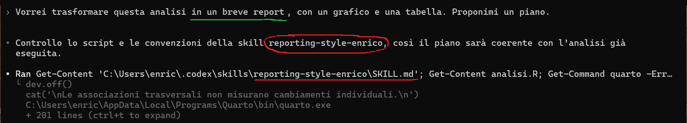</a>
<p class="cap">da terminale: <code>Ran Get-Content … reporting-style-enrico/SKILL.md</code></p>

## lo stesso, dall'app

<a href="https://github.com/EnricoToffalini/ai-skills" target="_blank" rel="noopener noreferrer" class="media-link" title="Apri le mie skill su GitHub in una nuova scheda">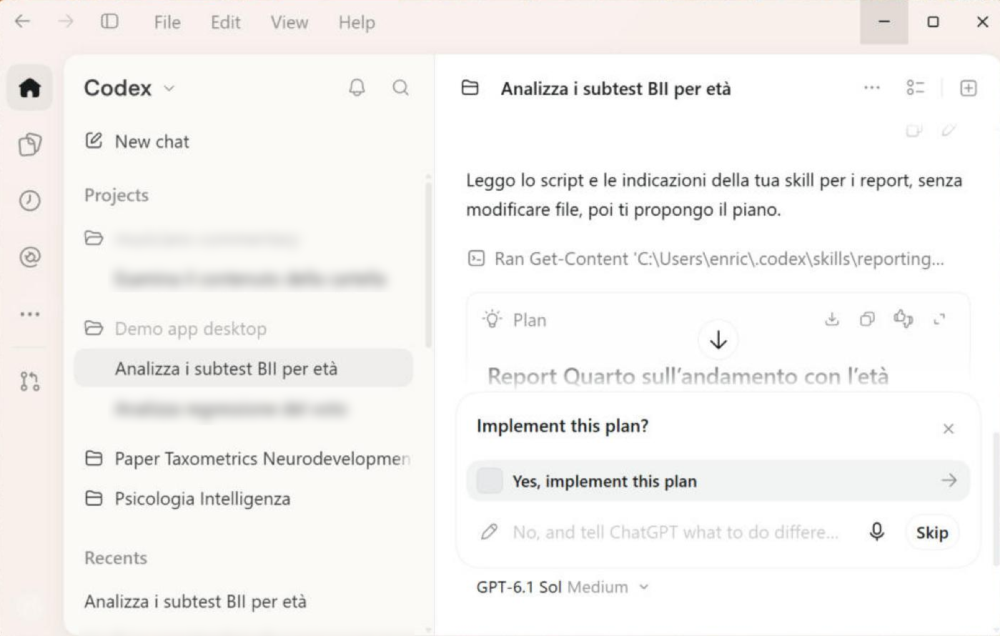</a>
<p class="cap">prima la skill (riga <i>Ran Get-Content … SKILL.md</i>), poi direttamente il piano: stavolta nessuna domanda</p>

## dove si mettono

:::: {.columns}
::: {.column width="50%"}
<a href="https://enricotoffalini.github.io/blog/posts/skills/#dove-si-usano-chat-e-agenti" target="_blank" rel="noopener noreferrer" class="media-link" title="Apri la sezione pertinente della guida in una nuova scheda">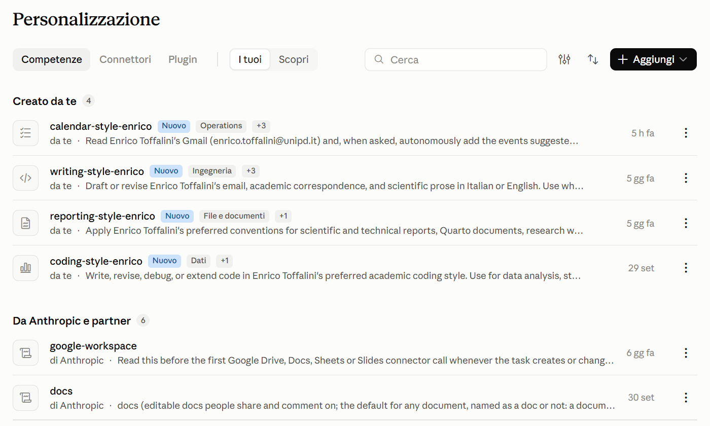</a>
<p class="cap">Claude, <i>Personalizzazione → Competenze</i></p>
:::
::: {.column width="50%"}
<a href="https://enricotoffalini.github.io/blog/posts/skills/#dove-si-usano-chat-e-agenti" target="_blank" rel="noopener noreferrer" class="media-link" title="Apri la sezione pertinente della guida in una nuova scheda">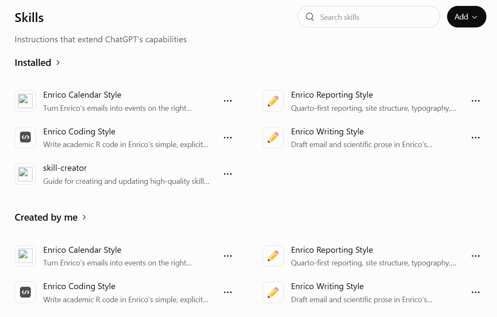</a>
<p class="cap">ChatGPT Edu, pagina <i>Skills</i>, poi <b>@</b></p>
:::
::::

<div class="small">

| strumento | cartella delle skill |
|---|---|
| **Claude Code** | `~/.claude/skills/` (tutti i progetti) · `.claude/skills/` (un progetto) |
| **Codex** | `~/.codex/skills/` · vale anche per l'app |

</div>


```{=html}
<div class="trucco">Non serve richiamarle: si attivano da sole. Se una conta davvero, chiamatela per nome: <code>/nome-skill</code> o <b>@</b>.</div>
```


## oltre lo stile: condensare un'expertise

:::: {.columns}
::: {.column width="55%"}
```markdown
---
name: cfa-lavaan
description: Run and report CFA and measurement
  invariance in R with lavaan. Use when the user
  asks to fit or report CFA models, test
  invariance across groups, or check the factor
  structure of a questionnaire.
---

- Ordinal items (< 5 categories): WLSMV,
  ordered = TRUE. Otherwise MLR + FIML.
- Report chi-square, CFI, TLI, RMSEA (90% CI), SRMR.
- Never add residual covariances only to
  improve fit without a justification.
For reporting tables, read references/reporting.md.
```
<p class="cap"><a href="https://enricotoffalini.github.io/blog/posts/skills/#oltre-lo-stile-condensare-unexpertise" target="_blank" rel="noopener noreferrer" title="Apri la sezione pertinente in una nuova scheda">scheletro semplificato e altri esempi</a></p>
:::
::: {.column width="45%"}
<div class="small">

Altre idee per il lab:

- **potenza** via simulazione, secondo uno schema
- **scoring** di uno strumento, con le norme
- **meta-analisi**, dalla codifica al forest plot
- **revisione** di manoscritti con una checklist
- **quiz** importabili su Moodle
- procedure di **tesi e tirocini**

</div>


```{=html}
<a href="https://github.com/EnricoToffalini/ai-skills" target="_blank" rel="noopener noreferrer" title="Apri approfondimento in una nuova scheda" class="panel-link principio">Una repository comune di skill: un <b>manuale di laboratorio</b> che l'AI applica.</a>
```

:::
::::

## scriverne una: sei cose da sapere

<div class="small">

1. **partite da una frustrazione**, non da un documento completo
2. **curate la descrizione**: cosa fa e **quando** usarla
3. **concreti**: "usa `=` per l'assegnazione", non "scrivi codice chiaro"
4. dite anche cosa **non** fare ("non cancellare mai eventi")
5. `SKILL.md` **corto**; i dettagli in file a parte
6. **fatevi aiutare**: [*skill-creator*](https://github.com/anthropics/skills/blob/main/skills/skill-creator/SKILL.md){target="_blank" rel="noopener noreferrer"}, oppure date all'agente il vostro codice o le vostre email e chiedete di ricavarne le convenzioni, o di **intervistarvi**

</div>


```{=html}
<a href="https://github.com/EnricoToffalini/ai-skills" target="_blank" rel="noopener noreferrer" title="Apri approfondimento in una nuova scheda" class="panel-link trucco">Poi usatele e rivedetele: ogni volta che l'AI sbaglia nonostante la skill, la regola mancava o era scritta male. Tenetele sotto Git.</a>
```


## le mie, da cui partire

<a href="https://github.com/EnricoToffalini/ai-skills" target="_blank" rel="noopener noreferrer" class="media-link" title="Apri le mie skill su GitHub in una nuova scheda"></a>
<p class="cap"><a href="https://github.com/EnricoToffalini/ai-skills" target="_blank" rel="noopener noreferrer">github.com/EnricoToffalini/ai-skills</a> · codice, report, scrittura, calendario, FAIR check</p>


```{=html}
<a href="https://github.com/EnricoToffalini/ai-skills" target="_blank" rel="noopener noreferrer" title="Apri approfondimento in una nuova scheda" class="panel-link trucco">Personali (alcune personalissime: gli ID dei miei calendari). Non copiatele così come sono: usatele come modello. E le skill altrui <b>leggetele prima</b>: girano con i vostri permessi.</a>
```


<!-- ============================ CHIUSURA ============================ -->

# {#ultime-cose .dark background-gradient="radial-gradient(82.5% 102.7% at 10% 0%, rgba(255,90,31,0.32), transparent 65%), radial-gradient(90.75% 117.3% at 95% 100%, rgba(124,58,237,0.42), transparent 65%), radial-gradient(43.75% 55.6% at 60% 40%, rgba(230,35,126,0.14), transparent 70%), linear-gradient(#0d1017, #0d1017)"}

<div class="act-num">Extra</div>
<div class="big">ultime cose</div>
<p class="muted">costi, precauzioni e da dove partire</p>

## quanto costa

:::: {.columns}
::: {.column width="55%"}
<div class="small">

- [**ChatGPT Edu**](https://enricotoffalini.github.io/blog/posts/gpt-edu/){target="_blank" rel="noopener noreferrer"} (UniPD): ~8.6 € al mese, Codex incluso
- [**ChatGPT Plus**](https://chatgpt.com/pricing/){target="_blank" rel="noopener noreferrer"}: ~20 $ + IVA al mese, Codex incluso
- [**Claude Pro**](https://claude.com/pricing){target="_blank" rel="noopener noreferrer"}: ~22 € al mese, Claude Code incluso
- limiti su **5 ore** e sulla **settimana**; poi l'agente si ferma
- per me una finestra di 5 ore basta per parecchi compiti

<p class="muted">ottobre 2026; cambia spesso</p>

<div class="avviso" style="font-size: 0.6em;">da dicembre, su ChatGPT Plus, anche la Chat (tranne <i>Instant</i>) consuma i limiti di Codex: un unico budget, come con Claude</div>

</div>
:::
::: {.column width="45%"}
<a href="https://enricotoffalini.github.io/blog/posts/agenti-cli/claude-code.html#controllare-lutilizzo-residuo" target="_blank" rel="noopener noreferrer" class="media-link" title="Apri la sezione pertinente della guida in una nuova scheda"></a>
:::
::::


```{=html}
<div class="trucco">
<ul>
<li> Se potete, fatevi dare licenza <b>GPT Edu</b>! e iniziate con <b>Codex</b>.</li> 
<li> Volete (anche) pagare di tasca vostra? Secondo me, <b>Claude Pro</b>.</li>
</ul>
</div>
```


## precauzioni

<div>

- [**Git**](https://enricotoffalini.github.io/blog/posts/tutorial-git-quarto/){target="_blank" rel="noopener noreferrer"}, o almeno una copia: l'agente può cancellare file
- **dati sensibili**: quello che legge va sui server del fornitore (piani per aziende tipo GPT Edu danno garanzie)
- **autonomia graduale**: prima piano e approvazione, poi il resto
- [**skill e connettori altrui**](https://enricotoffalini.github.io/blog/posts/skills/#precauzioni){target="_blank" rel="noopener noreferrer"}: leggerli prima (girano con i vostri permessi)
- **responsabilità**: codice che gira ≠ numeri giusti

</div>

<div class="fragment inchiostro">Mai fidarsi di qualcosa che pensa da solo, se non vedi dove tiene il cervello.</div>

## domani mattina

<div>

1. terminale **in una cartella di progetto** (meglio se con Git), poi `codex` o `claude`
2. prima un **piano**; poi leggete cosa fa
3. un `AGENTS.md` di tre righe: cosa c'è, cosa non toccare, come si fa il render
4. ChatGPT Edu: **Chat a High**, <b>@</b> per i connettori, progetti con fonti
5. terza volta che correggete la stessa cosa? **skill**

</div>

## per saperne di più

<div style="display: grid; grid-template-columns: repeat(5, 1fr); gap: 0.5em; margin-top: 0.8em;">
<div class="qr"><a href="https://enricotoffalini.github.io/blog/posts/serie-ai/" target="_blank" rel="noopener noreferrer" class="media-link" title="Apri la guida e i materiali in una nuova scheda"></a><br><a href="https://enricotoffalini.github.io/blog/posts/serie-ai/" target="_blank" rel="noopener noreferrer">la serie</a></div>
<div class="qr"><a href="https://enricotoffalini.github.io/blog/posts/agenti-cli/" target="_blank" rel="noopener noreferrer" class="media-link" title="Apri la guida e i materiali in una nuova scheda"></a><br><a href="https://enricotoffalini.github.io/blog/posts/agenti-cli/" target="_blank" rel="noopener noreferrer">1 · agenti in locale</a></div>
<div class="qr"><a href="https://enricotoffalini.github.io/blog/posts/gpt-edu/" target="_blank" rel="noopener noreferrer" class="media-link" title="Apri la guida e i materiali in una nuova scheda"></a><br><a href="https://enricotoffalini.github.io/blog/posts/gpt-edu/" target="_blank" rel="noopener noreferrer">2 · ChatGPT Edu</a></div>
<div class="qr"><a href="https://enricotoffalini.github.io/blog/posts/skills/" target="_blank" rel="noopener noreferrer" class="media-link" title="Apri la guida e i materiali in una nuova scheda"></a><br><a href="https://enricotoffalini.github.io/blog/posts/skills/" target="_blank" rel="noopener noreferrer">3 · skill</a></div>
<div class="qr"><a href="https://github.com/EnricoToffalini/ai-skills" target="_blank" rel="noopener noreferrer" class="media-link" title="Apri le mie skill su GitHub in una nuova scheda"></a><br><a href="https://github.com/EnricoToffalini/ai-skills" target="_blank" rel="noopener noreferrer">le mie skill</a></div>
</div>

<p class="center small" style="margin-top: 1em;"><a href="https://opensciencedpg.github.io/OS-promotion/" target="_blank" rel="noopener noreferrer">Open Science DPG</a> · guide passo-passo a <a href="https://enricotoffalini.github.io/blog/posts/agenti-cli/claude-code.html" target="_blank" rel="noopener noreferrer">Claude Code</a>, <a href="https://enricotoffalini.github.io/blog/posts/agenti-cli/codex.html" target="_blank" rel="noopener noreferrer">Codex</a> e <a href="https://enricotoffalini.github.io/blog/posts/agenti-cli/app-desktop.html" target="_blank" rel="noopener noreferrer">app desktop</a></p>


